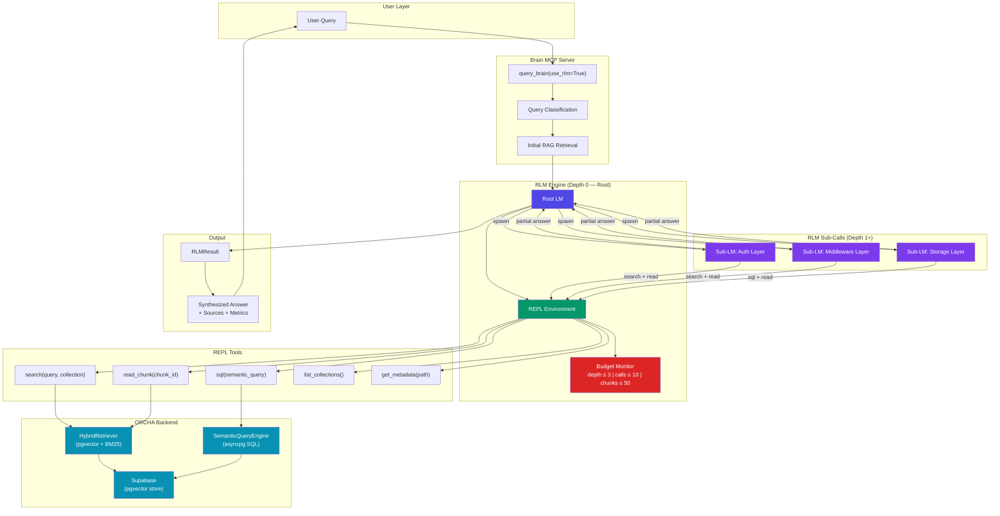

# Appendix A — Recursive Language Models (RLMs) for Unbounded Context

> *"The flywheel OS must handle contexts that grow without bound. RLMs are the inference paradigm that makes this possible — not by expanding the context window, but by teaching the model to decompose it."*

---

## A.1 RLM Overview

### Core Architecture

Recursive Language Models (RLMs) are a task-agnostic inference paradigm introduced by Zhang et al. (arXiv:2512.24601). They replace the standard `llm.completion(prompt, model)` call with `rlm.completion(prompt, model)`, enabling a language model to programmatically examine, decompose, and recursively call itself over its input.

The architecture has three components:

1. **Root LM (Depth 0):** Receives only the query — never the full context. Its job is to decide *how* to process the context, not to process it directly.

2. **Environment:** A Python REPL notebook that stores the full context as accessible variables. The Root LM writes code that runs inside this environment, inspecting and transforming the context programmatically.

3. **Recursive Sub-LMs (Depth 1+):** The Root LM spawns child LMs within the environment. Each child receives a *subset* of the context and can spawn further children. The recursion terminates when a sub-LM can answer its portion directly.

This is not retrieval-augmented generation. RAG selects *which* context to read. RLMs select *how* to read context — and the "how" can involve arbitrary computation, including further LM calls.

### Emergent Interaction Patterns

When given access to a REPL environment and recursive self-calls, LMs spontaneously develop five interaction patterns:

| Pattern | Behavior | Flywheel OS Analogy |
|---------|----------|---------------------|
| **Peeking** | Examine initial context sections to understand structure before processing | Stage 1 (Observe): the OS samples user behavior patterns before building the full model |
| **Grepping** | Keyword/regex search to narrow relevant data ranges | Brain MCP `search_symbol` / `search_code`: targeted retrieval before semantic processing |
| **Partition + Map** | Distribute context chunks across parallel recursive LM calls | meta-ralph manifest fanout: features distributed across parallel workers |
| **Summarization** | Extract key information from context subsets and propagate upward | Stage 2 (Infer): raw observations condensed into structured knowledge |
| **Programmatic Processing** | Direct code execution for structured tasks (counting, filtering, sorting) | Moby RAG pipeline: deterministic chunking, embedding, and storage — no LM needed |

The critical insight is that these patterns are **emergent**, not programmed. The model discovers them because the REPL environment makes them natural. This mirrors the flywheel's own emergent property: users do not plan to generate training data for the OS; they simply use it, and the flywheel spins.

---

## A.2 Performance Data

### OOLONG Benchmark (132K Tokens)

OOLONG tests long-context reasoning over 132,000 tokens of interleaved text — far beyond the effective attention span of most models, even those with 128K+ context windows.

| Model | Correct Answers | Notes |
|-------|-----------------|-------|
| GPT-5 (direct, 128K context) | Baseline | Full context in single window |
| GPT-5-mini (direct) | Below baseline | Smaller model, same context limits |
| **RLM(GPT-5-mini)** | **2x baseline** | Smaller model with recursive decomposition |

The result is counterintuitive: a *smaller* model with RLM inference *doubles* the performance of a larger model with direct context access. The recursive decomposition eliminates the "lost in the middle" problem — the well-documented failure mode where models attend weakly to information in the center of long contexts.

**Flywheel implication:** The personal knowledge graph (Layer 4 in the flywheel OS stack) grows without bound. After a year of use, a user's graph may contain millions of entity-relationship triples. RLM inference enables the on-device model (Layer 3) to reason over this entire graph without requiring proportional growth in the context window or the model itself.

### BrowseComp-Plus (10–1,000 Documents)

BrowseComp-Plus tests information retrieval and synthesis across document collections ranging from 10 to 1,000 documents.

| Model | 10 Docs | 100 Docs | 1,000 Docs |
|-------|---------|----------|------------|
| Direct LM | High | Degraded | Failed |
| **RLM** | **Perfect** | **Perfect** | **Perfect** |

RLM maintained perfect performance at all scales. Direct LM performance collapsed as document count increased — a pattern that is structurally identical to the flywheel's scaling challenge: as the personal model accumulates more data, query quality must not degrade.

---

## A.3 ORCHA Mapping Table

The RLM architecture maps cleanly onto ORCHA's existing components. This is not coincidence — both systems solve the same problem (managing unbounded context through decomposition) in structurally similar ways.

| RLM Concept | ORCHA Component | Shared Principle |
|-------------|-----------------|------------------|
| Root LM (Depth 0) | Crew Leader / meta-ralph orchestrator | Receives the goal, not the full context; decides decomposition strategy |
| REPL Environment | Event Bus + Git Worktree isolation | Shared state accessible by all sub-processes; isolated execution contexts |
| Recursive Sub-LMs (Depth 1+) | Crew Workers / meta-ralph feature workers | Each receives a context subset; can further decompose |
| Peeking pattern | `/code-explore` skill | Sample structure before committing to a processing strategy |
| Grepping pattern | `mcp___brain__search_symbol` | Targeted keyword retrieval to narrow the search space |
| Partition + Map | meta-ralph batch execution | Independent features distributed across parallel workers |
| Summarization | Brain MCP `query_brain` | Synthesize answers from retrieved context subsets |
| Programmatic Processing | Moby RAG pipeline (chunking, embedding, SQL) | Deterministic computation — no LM inference needed |
| Depth limit | Manifest batch dependencies | Prevents infinite recursion; each depth level has bounded scope |
| Environment variables | `.env` + Supabase tenant context | Configuration accessible at all recursion depths |

### Structural Correspondence

```
RLM Architecture              ORCHA Architecture
─────────────────              ──────────────────
User Query                     Feature Request / Manifest
    │                              │
    ▼                              ▼
Root LM (Depth 0)             Crew Leader / meta-ralph
    │                              │
    ├── REPL Environment       ├── Event Bus (shared state)
    │                          ├── Git Worktrees (isolation)
    │                              │
    ├── Sub-LM (Depth 1)      ├── Worker 1 (Feature A)
    ├── Sub-LM (Depth 1)      ├── Worker 2 (Feature B)
    └── Sub-LM (Depth 1)      └── Worker 3 (Feature C)
         │                          │
         └── Sub-LM (Depth 2)      └── Sub-task (test, impl, PR)
```

---

## A.4 Integration Spec: RLM-Backed Query Pipeline

### Problem Statement

The current Brain MCP query pipeline operates in a single pass: retrieve relevant chunks via hybrid search (vector + BM25), then synthesize an answer from the top-K results. This works well for queries where the answer exists in a small number of chunks, but fails for:

- **Cross-cutting queries:** "How does authentication flow from the frontend through the middleware to the database?" — requires following a chain across 10+ files.
- **Aggregation queries:** "Which modules have the most test coverage gaps?" — requires scanning many files and computing statistics.
- **Comparative queries:** "How does the HVN tenant's data model differ from YardSage's?" — requires parallel retrieval from two collections.

### Proposed Architecture

Replace the single-pass synthesis step with an RLM inference loop. The existing RAG retrieval becomes one of several tools available to the RLM's REPL environment.

**Pipeline stages:**

1. **Query Classification** (existing Brain MCP logic) — determines search strategy: vector, BM25, or hybrid.

2. **Context Assembly** — retrieves initial chunk set (unchanged from current pipeline).

3. **RLM Inference Loop** (new) — the RLM receives the query and a set of REPL tools:
   - `search(query, collection_id)` — trigger additional RAG retrievals
   - `read_chunk(chunk_id)` — read a specific chunk's full content
   - `sql(query)` — run a semantic SQL query via the SemanticQueryEngine
   - `list_collections()` — discover available collections
   - `get_metadata(file_path)` — retrieve file metadata (last modified, size, language)

4. **Answer Synthesis** — the RLM produces the final answer, having recursively explored the context to whatever depth was needed.

### Resource Constraints

The RLM loop must operate within bounded resources to prevent runaway inference:

| Parameter | Default | Rationale |
|-----------|---------|-----------|
| `max_depth` | 3 | Prevents infinite recursion |
| `max_sub_calls` | 10 | Bounds total LM invocations per query |
| `timeout_seconds` | 30 | Hard wall-clock limit |
| `max_chunks_read` | 50 | Prevents excessive database load |
| `environment` | `local` | No sandbox overhead for trusted codebase queries |

### Fallback Behavior

If the RLM loop exhausts its budget without converging on an answer, the system falls back to the current single-pass synthesis — ensuring the RLM integration is strictly additive. No existing query degrades.

---

## A.5 Implementation Spec: RLM Wrapper Around Brain MCP

### Module Location

```
packages/orcha-moby/src/orcha_moby/rlm/
├── __init__.py          # Public exports
├── engine.py            # RLMEngine: recursive inference loop
├── environment.py       # REPLEnvironment: tool registry + execution
├── tools.py             # REPL tools (search, read_chunk, sql, etc.)
└── config.py            # RLMConfig: depth, timeout, budget limits
```

### Key Classes

**`RLMConfig`** — Pydantic frozen model controlling recursion limits:

```python
class RLMConfig(BaseModel, frozen=True):
    max_depth: int = Field(default=3, ge=1, le=10)
    max_sub_calls: int = Field(default=10, ge=1, le=50)
    timeout_seconds: float = Field(default=30.0, ge=1.0, le=120.0)
    max_chunks_read: int = Field(default=50, ge=1, le=200)
    environment: Literal["local", "modal", "prime"] = "local"
```

**`REPLEnvironment`** — manages the tool registry and execution state:

```python
class REPLEnvironment:
    def __init__(self, tools: dict[str, Callable], context_vars: dict[str, Any]):
        self._tools = tools
        self._context = context_vars
        self._call_count = 0
        self._chunks_read = 0

    async def execute(self, code: str) -> Any:
        """Execute code in the REPL with access to tools and context."""
        ...

    def budget_remaining(self) -> dict[str, int]:
        """Return remaining budget for sub-calls and chunk reads."""
        ...
```

**`RLMEngine`** — the recursive inference coordinator:

```python
class RLMEngine:
    def __init__(
        self,
        config: RLMConfig,
        retriever: HybridRetriever,
        query_engine: SemanticQueryEngine | None = None,
    ):
        ...

    async def completion(self, query: str, collection_id: str = "") -> RLMResult:
        """Run RLM inference loop over the indexed codebase."""
        ...
```

**`RLMResult`** — the return type:

```python
class RLMResult(BaseModel, frozen=True):
    response: str
    depth_reached: int
    sub_calls_used: int
    chunks_read: int
    elapsed_seconds: float
    sources: list[str]
```

### Brain MCP Integration Point

The RLM engine integrates at the `query_brain` tool level in `mcp-servers/brain/server.py`:

```python
@mcp.tool()
async def query_brain(query: str, ..., use_rlm: bool = False) -> str:
    if use_rlm:
        engine = RLMEngine(config=rlm_config, retriever=retriever)
        result = await engine.completion(query, collection_id=collection_ids)
        return format_rlm_response(result)
    else:
        # Existing single-pass synthesis
        ...
```

The `use_rlm` flag defaults to `False`, making the integration opt-in. Users can enable it for complex queries where single-pass synthesis is insufficient.

---

## A.6 Code Example: RLM Completion with ORCHA Context

```python
"""
Example: Using the RLM engine to answer a cross-cutting codebase question
that would fail with single-pass RAG.
"""
import asyncio
from orcha_moby.rlm import RLMEngine, RLMConfig, REPLEnvironment
from orcha_moby.rag.retrieval import HybridRetriever
from orcha_moby.semantic import SemanticQueryEngine
from orcha_moby.storage.supabase_config import SupabaseConfig


async def main():
    # 1. Initialize the retriever (existing ORCHA component)
    config = SupabaseConfig()  # reads from env: SUPABASE_URL, SUPABASE_KEY, etc.
    retriever = HybridRetriever(config=config)
    await retriever.connect()

    # 2. Initialize the semantic query engine (existing ORCHA component)
    query_engine = SemanticQueryEngine()

    # 3. Configure the RLM with conservative limits
    rlm_config = RLMConfig(
        max_depth=3,
        max_sub_calls=10,
        timeout_seconds=30.0,
        max_chunks_read=50,
        environment="local",
    )

    # 4. Create the RLM engine
    engine = RLMEngine(
        config=rlm_config,
        retriever=retriever,
        query_engine=query_engine,
    )

    # 5. Ask a cross-cutting question
    #    This query requires following the auth flow across 4+ modules:
    #    JWT creation → middleware validation → RLS policy → tenant scoping
    result = await engine.completion(
        query="Trace the authentication flow from JWT creation through "
              "Supabase RLS to tenant-scoped queries. Which files are involved "
              "and what are the security boundaries at each layer?",
        collection_id="col-orcha-source",
    )

    # 6. Inspect the result
    print(f"Answer:\n{result.response}\n")
    print(f"Depth reached: {result.depth_reached}")
    print(f"Sub-calls used: {result.sub_calls_used}/{rlm_config.max_sub_calls}")
    print(f"Chunks read: {result.chunks_read}/{rlm_config.max_chunks_read}")
    print(f"Elapsed: {result.elapsed_seconds:.1f}s")
    print(f"Sources: {len(result.sources)} files")
    for source in result.sources:
        print(f"  - {source}")

    await retriever.disconnect()


if __name__ == "__main__":
    asyncio.run(main())

# Expected output (illustrative):
#
# Answer:
# The authentication flow has four layers:
#
# 1. **JWT Creation** (`orcha_moby/storage/supabase_auth.py`):
#    - `create_tenant_jwt()` signs a JWT with HMAC-SHA256
#    - Claims include: tenant_id, role, expiration
#
# 2. **Middleware Validation** (`harness/src/agent_harness/middleware/auth.py`):
#    - Extracts JWT from Authorization header
#    - Validates signature, expiration, and tenant claim
#    - Attaches tenant context to request state
#
# 3. **RLS Policy** (Supabase PostgreSQL):
#    - `auth.jwt() ->> 'tenant_id'` used in RLS policies
#    - All tables have tenant_id column with RLS enforced
#
# 4. **Application Scoping** (`orcha_moby/storage/supabase_vector.py`):
#    - `SupabaseVectorStorage` adds `tenant_id` filter to all queries
#    - Double protection: RLS + application-level filtering
#
# Depth reached: 2
# Sub-calls used: 4/10
# Chunks read: 12/50
# Elapsed: 8.3s
# Sources: 4 files
#   - packages/orcha-moby/src/orcha_moby/storage/supabase_auth.py
#   - harness/src/agent_harness/middleware/auth.py
#   - supabase/migrations/20240101_rls_policies.sql
#   - packages/orcha-moby/src/orcha_moby/storage/supabase_vector.py
```

---

## A.7 Integration Diagram



### Reading the Diagram

1. **Top-down flow:** A user query enters the Brain MCP server, which classifies it and performs an initial RAG retrieval.

2. **Root LM decision:** The Root LM (indigo) receives the query and initial context. It does not attempt to answer directly. Instead, it writes code in the REPL Environment (green) to decompose the problem.

3. **Recursive decomposition:** The Root LM spawns three Sub-LMs (purple), one per architectural layer in the auth flow example. Each Sub-LM gets a focused sub-query and access to the same REPL tools.

4. **Tool access:** All LMs — root and sub — access the ORCHA backend (teal) through the REPL tools. The HybridRetriever handles vector + BM25 search; the SemanticQueryEngine handles SQL aggregation.

5. **Budget enforcement:** The Budget Monitor (red) tracks depth, sub-call count, and chunks read. If any limit is reached, the current recursion level returns its best partial answer.

6. **Bottom-up synthesis:** Partial answers from Sub-LMs flow back to the Root LM, which synthesizes the final `RLMResult` — including the answer text, source files, and resource usage metrics.

---

## References

- Zhang, A. et al. (2025). "Recursive Language Models." arXiv:2512.24601. https://arxiv.org/abs/2512.24601
- Repository: https://github.com/alexzhang13/rlm
- OOLONG Benchmark: 132K-token long-context evaluation suite
- BrowseComp-Plus: Multi-document retrieval and synthesis benchmark (10–1,000 documents)
