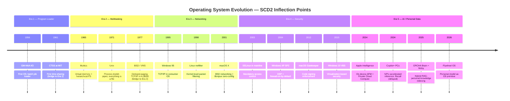

# Chapter 1: The Historical Arc — Why This Is Inevitable

> Every major era in OS history follows the same pattern: an external force makes
> the OS responsible for something it previously ignored. Each transition adds new
> slowly-changing attributes to the OS dimension — new columns that didn't exist
> before, new SCD2 triggers that change the meaning of "current state."

---

## 1.1 The Pattern

Operating systems don't evolve by choice. They evolve because the world outside
the machine changes, and the machine must adapt or become irrelevant. Each era
follows a three-beat rhythm:

1. **External pressure** — A force outside the OS (hardware economics,
   networking, adversarial threats, AI capability) creates a new class of
   problems that existing software can't handle.
2. **OS absorption** — The OS absorbs responsibility for the new problem domain,
   moving it from user space into kernel space or into first-party system
   services.
3. **SCD2 inflection** — The change creates a new slowly-changing attribute on
   the OS dimension. What was previously untracked becomes a defining
   characteristic of the system's "current state."

This isn't a metaphor. It's a data modeling observation. If you were building a
Kimball-style data warehouse to track operating system configurations across
time, you'd need to add new columns — new SCD2-triggering attributes — at each
era boundary. The OS dimension table grows wider because the OS itself grows
more responsible.

---

## 1.2 Era 1: The Program Loader (1950s–1960s)

### What the OS Did

The earliest operating systems weren't operating systems in the modern sense.
They were **batch monitors** — programs whose sole purpose was to load the next
program. IBM's IBSYS (1960), the GM-NAA I/O System (1956), and early FORTRAN
Monitor Systems existed to minimize idle time between jobs on expensive
mainframes.

The OS managed one thing: **the transition between programs**. It loaded a deck
of punch cards, ran the program, captured the output on a line printer, and
loaded the next deck. There was no multitasking, no memory protection, no file
system in the modern sense. The "state" of the system was the current job in the
queue.

### The Dimensional View

A data warehouse tracking OS configurations in this era would need exactly two
columns:

| Attribute | Example Value |
|-----------|--------------|
| `os_name` | `IBSYS` |
| `batch_mode` | `serial` |

That's it. The OS was a program loader. Its "current state" was defined by which
batch queue it was processing.

### SCD2 Trigger

The only SCD2 event was a **version upgrade** — replacing one batch monitor with
another. The concept of "the OS changed its configuration" barely existed because
the OS barely had configuration.

### Key Systems

- **GM-NAA I/O (1956)** — First operating system, written for the IBM 704
- **IBSYS (1960)** — IBM's batch processing monitor for the 7090/7094
- **FMS (1961)** — FORTRAN Monitor System
- **CTSS (1961)** — Compatible Time-Sharing System at MIT (bridge to Era 2)

---

## 1.3 Era 2: Multitasking and Virtual Memory (1970s–1980s)

### The External Pressure

Two forces converged. First, **hardware costs dropped** enough that dedicated
mainframe time for a single user became economically wasteful. Second,
**interactive computing** — terminals, editors, debuggers — demanded that
multiple users share the machine simultaneously. You can't edit a file
interactively if you're waiting in a batch queue.

### What the OS Absorbed

The OS became responsible for **resource arbitration**: CPU scheduling, memory
management, and process isolation. This was a categorical expansion.
The OS went from "load the next program" to "run many programs simultaneously
and prevent them from interfering with each other."

Unix (1969/1971), Multics (1965), and VMS (1977) defined the paradigm.
Virtual memory meant the OS had to track memory mappings. Process scheduling
meant the OS had to track process state. File systems meant the OS had to track
persistent storage.

### The Dimensional View

The OS dimension table explodes:

| Attribute | Example Value | SCD2? |
|-----------|--------------|-------|
| `os_name` | `Unix V7` | Type 1 |
| `batch_mode` | `interactive` | Type 2 |
| `max_processes` | `64` | Type 2 |
| `virtual_memory_enabled` | `true` | Type 2 |
| `file_system_type` | `UFS` | Type 2 |
| `user_model` | `multi-user` | Type 2 |
| `scheduler_type` | `preemptive` | Type 2 |

Six new SCD2 columns. Each one represents something the OS is now responsible
for that it previously ignored. Change any one, and you have a new row in the
dimension — a new "version" of the OS configuration.

### SCD2 Trigger

Configuration changes to scheduling policy, memory limits, file system type, or
user model all trigger new dimension rows. The OS now has *state* that matters
to its users.

### Key Systems

- **Multics (1965)** — First system with hierarchical file system + virtual memory
- **Unix (1971)** — Minimalist rethinking of Multics; defined the process model
- **VMS (1977)** — VAX/VMS introduced demand-paged virtual memory at scale
- **BSD (1977–1983)** — Added virtual memory (3BSD) and TCP/IP (4.2BSD, bridge to Era 3)

---

## 1.4 Era 3: Networking (1990s–2000s)

### The External Pressure

The Internet. Specifically, the transition from isolated networks (DECnet,
SNA, Novell IPX) to a universal, publicly routable protocol stack (TCP/IP).
By the mid-1990s, every computer was expected to reach every other computer.

### What the OS Absorbed

The OS became responsible for **network identity and communication**: TCP/IP
stacks, DNS resolution, socket APIs, firewall rules, and eventually HTTP/TLS
as first-class capabilities. Before this era, networking was an add-on — a TSR
on DOS, a separate application on early Mac. After, the OS *was* the network
interface.

Windows 95 shipping with a built-in TCP/IP stack (1995), Linux's netfilter/
iptables (1998), and macOS X's BSD networking layer (2001) all reflected the
same absorption. The OS went from "manages local resources" to "manages the
machine's relationship with every other machine on Earth."

### The Dimensional View

Another expansion:

| Attribute | Example Value | SCD2? |
|-----------|--------------|-------|
| `network_stack` | `TCP/IP` | Type 2 |
| `dns_config` | `dhcp-assigned` | Type 2 |
| `firewall_policy` | `stateful` | Type 2 |
| `tls_version` | `1.0` | Type 2 |
| `network_identity` | `hostname.domain` | Type 2 |
| `default_gateway` | `192.168.1.1` | Type 2 |

Every one of these is something the OS now tracks, can change, and whose change
is meaningful. A change to `firewall_policy` from `none` to `stateful` is an
SCD2 event — the OS's "current state" is materially different.

### SCD2 Trigger

Network configuration changes, TLS upgrades, firewall policy modifications, and
DNS resolver changes all create new dimension rows. The OS's state now includes
its *network posture* — something completely nonexistent in Era 1.

### Key Systems

- **Windows 95 (1995)** — TCP/IP integrated into consumer OS
- **Linux 2.2+ (1999)** — netfilter/iptables; kernel-level packet filtering
- **macOS X (2001)** — BSD networking + Rendezvous/Bonjour for zero-config
- **Windows XP SP2 (2004)** — Windows Firewall enabled by default (bridge to Era 4)

---

## 1.5 Era 4: Security (2000s–2010s)

### The External Pressure

Once every computer was networked, every computer was a target. Code Red (2001),
SQL Slammer (2003), Conficker (2008), and Stuxnet (2010) demonstrated that
network connectivity without OS-level security was catastrophic. The external
force was **adversarial threat actors** — nation-states, criminal enterprises,
and script kiddies — exploiting the networking capabilities absorbed in Era 3.

### What the OS Absorbed

The OS became responsible for **security as a system property**: mandatory access
controls (SELinux, AppArmor), address space layout randomization (ASLR), Data
Execution Prevention (DEP/NX), signed code enforcement, sandboxing, and
automatic patching. Security moved from "install an antivirus" to "the OS kernel
enforces security policies at every level."

This was the most contentious absorption. Firewalls broke enterprise
applications. UAC prompts frustrated Windows Vista users. SELinux in enforcing
mode was (and sometimes still is) the first thing sysadmins disable. But the
direction was irreversible — the OS *had* to own security because no one else
could.

### The Dimensional View

The dimension table expands again:

| Attribute | Example Value | SCD2? |
|-----------|--------------|-------|
| `mandatory_access_control` | `SELinux enforcing` | Type 2 |
| `aslr_enabled` | `true` | Type 2 |
| `dep_enabled` | `true` | Type 2 |
| `code_signing_required` | `true` | Type 2 |
| `sandbox_policy` | `app-level` | Type 2 |
| `patch_level` | `2024-01-KB5034441` | Type 2 |
| `tls_version` | `1.3` | Type 2 (updated) |
| `encryption_at_rest` | `BitLocker/FileVault` | Type 2 |

Every security configuration change — every patch, every policy toggle — is an
SCD2 event. The OS now has a *security posture* that changes frequently and
matters enormously.

### SCD2 Trigger

Patch installations, security policy changes, certificate rotations, and access
control modifications all trigger new rows. The frequency of SCD2 events
increases by an order of magnitude compared to Era 3 — monthly patch cycles
alone generate 12+ dimension changes per year.

### Key Systems

- **Windows XP SP2 (2004)** — DEP, Windows Firewall on by default, Security Center
- **SELinux (2003)** — NSA-developed mandatory access control in Linux kernel
- **macOS Gatekeeper (2012)** — Code signing enforcement for applications
- **Windows 10 (2015)** — WDAC, Credential Guard, VBS; security as platform feature
- **iOS App Sandbox (2008)** — Per-app sandboxing; bridge to Era 5 (privacy)

---

## 1.6 Era 5: AI and Personal Data (2020s+)

### The External Pressure

Three forces converge simultaneously:

1. **Foundation models** reach the capability threshold where they can understand
   and generate human-quality text, code, and multimodal content.
2. **On-device inference hardware** (Apple Neural Engine, Qualcomm Hexagon NPU,
   Intel Meteor Lake NPU) provides 40+ TOPS without cloud dependency.
3. **User expectation** shifts from "the computer does what I tell it" to "the
   computer anticipates what I need."

The external pressure isn't a threat (like Era 4) — it's an **opportunity**.
The OS that incorporates personal data intelligence creates a positive-sum
flywheel: more usage generates more personal data, which makes the OS smarter,
which increases usage. Unlike security patches (defensive, reactive), AI
integration is *generative*.

### What the OS Will Absorb

The OS becomes responsible for **personal intelligence**: maintaining a personal
knowledge graph, running on-device inference, managing a privacy-preserving
personal data vault, orchestrating multi-agent actions, and providing
contextual awareness to applications.

This is the most radical absorption yet. Previous eras added capabilities to
the OS. This era adds *knowledge about the user* to the OS. The OS doesn't
just manage files, processes, networks, and security. It manages **a model of
who you are and what you're trying to do**.

### The Dimensional View

The dimension table undergoes its most dramatic expansion:

| Attribute | Example Value | SCD2? |
|-----------|--------------|-------|
| `personal_model_version` | `v3.2.1-20260216` | Type 2 |
| `knowledge_graph_node_count` | `14,892` | Type 2 |
| `embedding_hash` | `sha256:a7b3c9...` | Type 2 |
| `inference_engine` | `AFM-3B-q4` | Type 2 |
| `autonomy_stage` | `3-predict` | Type 2 |
| `trust_score` | `0.87` | Type 2 |
| `observation_surface` | `email,calendar,files,browsing` | Type 2 |
| `privacy_gateway_mode` | `differential-privacy-epsilon-3` | Type 2 |
| `federated_learning_enabled` | `true` | Type 2 |
| `data_portability_format` | `PDML-v1` | Type 2 |

Every attribute here is *personal*. The OS dimension now includes columns that
are unique per user — not per machine, not per installation, but per person.
This is the fundamental break from all previous eras.

### SCD2 Trigger

Every meaningful interaction changes the personal model. The knowledge graph
grows. The embedding hash changes. The trust score shifts. The autonomy stage
advances. SCD2 events go from "monthly patch cycles" to "continuous" — the
personal model is *always* slowly changing.

### Current Precedents

- **Apple Intelligence (2024–26)** — On-device AFM, App Intents, Private Cloud Compute
- **Microsoft Copilot+ (2024)** — Recall (delayed), NPU-accelerated inference
- **Google Gemini Nano (2024)** — On-device model for Pixel; AI Core APIs
- **ORCHA Brain MCP + Moby RAG (2025–26)** — Hybrid retrieval, personal knowledge indexing, agent orchestration

---

## 1.7 The SCD2 Mapping: dim_os_era

The following table models the five eras as a Kimball-style SCD2 dimension. Each
era introduces new attributes that didn't exist in prior eras. The table shows
which columns are "active" (tracked and triggering SCD2 events) in each era.

| Attribute | Era 1: Loader | Era 2: Multitask | Era 3: Network | Era 4: Security | Era 5: AI/Personal |
|-----------|:---:|:---:|:---:|:---:|:---:|
| `os_name` | Active | Active | Active | Active | Active |
| `batch_mode` | Active | Active | Active | Active | Active |
| `max_processes` | — | Active | Active | Active | Active |
| `virtual_memory` | — | Active | Active | Active | Active |
| `file_system_type` | — | Active | Active | Active | Active |
| `user_model` | — | Active | Active | Active | Active |
| `scheduler_type` | — | Active | Active | Active | Active |
| `network_stack` | — | — | Active | Active | Active |
| `firewall_policy` | — | — | Active | Active | Active |
| `tls_version` | — | — | Active | Active | Active |
| `network_identity` | — | — | Active | Active | Active |
| `mandatory_access_control` | — | — | — | Active | Active |
| `aslr_enabled` | — | — | — | Active | Active |
| `code_signing_required` | — | — | — | Active | Active |
| `sandbox_policy` | — | — | — | Active | Active |
| `patch_level` | — | — | — | Active | Active |
| `encryption_at_rest` | — | — | — | Active | Active |
| `personal_model_version` | — | — | — | — | Active |
| `knowledge_graph_nodes` | — | — | — | — | Active |
| `inference_engine` | — | — | — | — | Active |
| `autonomy_stage` | — | — | — | — | Active |
| `trust_score` | — | — | — | — | Active |
| `observation_surface` | — | — | — | — | Active |
| `privacy_gateway_mode` | — | — | — | — | Active |

**Pattern**: Each era adds 4–8 new SCD2 columns. Era 5 is distinguished by
columns that are *per-user* rather than per-machine — a qualitative shift in
what the OS dimension represents.

---

## 1.8 The Kimball Dimension: `dim_os_era`

```sql
-- dim_os_era: Tracks OS configuration through historical eras (SCD2)
-- Each row represents a distinct "version" of the OS's tracked state.
-- New rows are created when any SCD2-triggering attribute changes.

CREATE TABLE dim_os_era (
    -- Surrogate key
    os_era_sk           BIGSERIAL PRIMARY KEY,

    -- Natural key
    os_installation_id  UUID NOT NULL,

    -- Era 1: Program Loader (1950s-60s)
    os_name             TEXT NOT NULL,
    os_version          TEXT NOT NULL,
    batch_mode          TEXT NOT NULL DEFAULT 'serial',

    -- Era 2: Multitasking (1970s-80s)
    max_processes       INT,
    virtual_memory_mb   INT,
    file_system_type    TEXT,
    user_model          TEXT,          -- 'single' | 'multi-user'
    scheduler_type      TEXT,          -- 'cooperative' | 'preemptive'

    -- Era 3: Networking (1990s-2000s)
    network_stack       TEXT,          -- 'none' | 'TCP/IP' | 'IPX'
    firewall_policy     TEXT,          -- 'none' | 'stateless' | 'stateful'
    tls_version         TEXT,
    network_identity    TEXT,

    -- Era 4: Security (2000s-2010s)
    mandatory_ac        TEXT,          -- 'none' | 'SELinux' | 'AppArmor'
    aslr_enabled        BOOLEAN,
    code_signing_req    BOOLEAN,
    sandbox_policy      TEXT,
    patch_level         TEXT,
    encryption_at_rest  TEXT,

    -- Era 5: AI/Personal Data (2020s+)
    personal_model_ver  TEXT,
    knowledge_graph_ct  INT,
    inference_engine    TEXT,
    autonomy_stage      TEXT,          -- 'observe' | 'infer' | 'predict' | 'act' | 'learn'
    trust_score         NUMERIC(4,3),
    observation_surface TEXT[],
    privacy_gw_mode     TEXT,

    -- SCD2 bookkeeping
    effective_from      TIMESTAMPTZ NOT NULL DEFAULT now(),
    effective_to        TIMESTAMPTZ,           -- NULL = current row
    is_current          BOOLEAN NOT NULL DEFAULT true,

    -- Audit
    created_at          TIMESTAMPTZ NOT NULL DEFAULT now()
);

-- Indexes for SCD2 lookups
CREATE INDEX idx_dim_os_era_natural ON dim_os_era (os_installation_id, is_current);
CREATE INDEX idx_dim_os_era_effective ON dim_os_era (os_installation_id, effective_from, effective_to);
```

---

## 1.9 Timeline Visualization



---

## 1.10 The Inevitability Argument

Each era transition seemed optional when it began and obvious in retrospect:

| Era Transition | "We Don't Need This" Argument | What Made It Inevitable |
|---------------|-------------------------------|------------------------|
| 1 → 2 | "Batch processing is sufficient" | Interactive terminals + falling hardware costs |
| 2 → 3 | "Networking is a specialist concern" | The Internet; email; the web |
| 3 → 4 | "Security is an application concern" | Code Red; Slammer; nation-state threats |
| 4 → 5 | "AI is a cloud/app concern" | On-device NPUs; foundation model capabilities; user expectations |

The pattern is always the same: the skeptic's argument is that the existing
layer boundaries are sufficient, and some external force proves them wrong.

The AI/Personal Data transition follows this pattern exactly. The argument
"AI belongs in applications, not the OS" is structurally identical to "security
belongs in applications, not the OS" — and we know how that resolved. The OS
absorbs what it must absorb.

The difference in Era 5 is the *nature* of what's absorbed. Previous eras
absorbed capabilities (multitasking, networking, security). Era 5 absorbs
*knowledge about the user*. The OS dimension goes from tracking machine state
to tracking personal state. This is the SCD2 inflection point that defines our
era: the column `personal_model_version` appears in the dimension table, and
nothing is the same again.

---

## Summary

The historical arc of operating systems is a story of expanding responsibility,
told through the language of dimensional modeling:

- **Era 1** introduced the OS dimension with 2 attributes.
- **Era 2** added 5 resource-management attributes.
- **Era 3** added 4 network-identity attributes.
- **Era 4** added 6 security-posture attributes.
- **Era 5** adds 7+ personal-intelligence attributes — and uniquely, these are
  *per-user* rather than per-machine.

Each era's SCD2 columns are still active in all subsequent eras. The dimension
table only grows. The OS only becomes more responsible. And the next inflection
point — the OS that knows you and gets smarter the more you use it — is not a
speculative leap. It's the same pattern, playing out for the fifth time.

---

*Next: [Chapter 2 — The Personal Data Flywheel: How It Works](ch02-flywheel-mechanics.md)*
