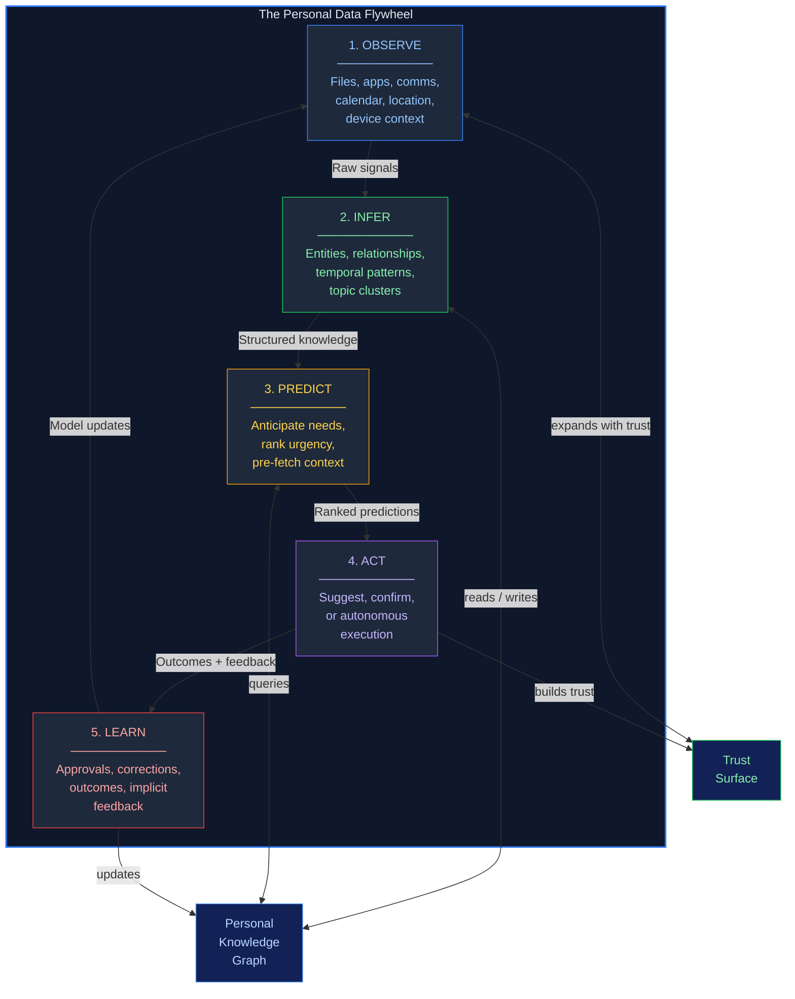

# Chapter 2 — The Personal Data Flywheel: How It Works

> *"The flywheel is a self-reinforcing loop where OS utility increases with personal data depth, which increases usage, which generates more personal data."*

---

## 2.1 The Core Insight

Every previous OS era was **defensive**. TCP/IP meant the OS had to defend against worms. Wi-Fi meant it had to defend against eavesdropping. Each era added responsibilities the OS had not asked for.

The AI era is fundamentally different: it is **positive-sum**. The more you use the system, the more it gives back. This is not a feature bolted onto an existing OS; it is a new operating principle. The OS stops being a platform you run software *on* and becomes a system that runs *for you*.

The mechanism is a flywheel: a five-stage loop where each stage feeds the next, and the output of the final stage accelerates the first. Flywheels are hard to start, but once spinning, they are hard to stop.

---

## 2.2 The Five Stages

The flywheel has five stages. They are ordered, but they are not linear. Stage 5 feeds back into Stage 1, and each full revolution makes the next revolution faster.

### Stage 1: Observe

The OS watches what you do — not to surveil, but to build a model of your world.

**What it captures:**
- Files you open, close, create, rename, and delete
- Applications you switch between and how long you spend in each
- Communication patterns: who you email, when, about what topics
- Calendar events, locations, device context (home/office/transit)
- Browsing patterns, search queries, document edits

**What it does NOT capture (by architecture, not policy):**
- Raw content of encrypted messages
- Anything outside the user's declared observation surface
- Data from applications that have not opted into the OS context API

**Design principle:** The observation layer is *expansible*. Users start with minimal observation and widen it as trust increases. The system never captures more than the user has explicitly permitted.

**Example:** The OS observes that every Monday at 9:00 AM, you open Slack, then your project management tool, then a specific Google Doc. It does not read the messages. It observes the *pattern*.

### Stage 2: Infer

The OS converts raw observations into structured knowledge.

**What it produces:**
- Entity recognition: "Project Alpha" is a project involving Alice, Bob, and Carol
- Relationship mapping: Alice is your manager; Carol is a vendor contact
- Temporal patterns: you write reports on Fridays; you schedule deep work on Wednesday mornings
- Topic clustering: your work spans three main domains this quarter
- Sentiment signals: your communication frequency with a client has dropped 40% this month

**How it works:**
The on-device foundation model (3-10B parameters, quantized for NPU execution) processes the observation stream through the Personal Knowledge Graph — a graph database of entities, relationships, preferences, and temporal patterns. Nodes represent people, projects, locations, documents, and habits. Edges represent relationships, frequencies, and contexts.

This is the flywheel's state. The Knowledge Graph is the thing that compounds.

**Example:** From observing your calendar, email, and file activity, the OS infers that you are preparing for a board presentation next Thursday. It knows this not because you told it, but because it recognized the pattern: increased activity on a specific slide deck, calendar blocks labeled "prep," and three emails to the CFO about numbers.

### Stage 3: Predict

The OS anticipates what you will need before you ask.

**What it predicts:**
- Which files you will need for your next meeting
- Who you are likely to email next and about what topic
- When you will run out of disk space, need to charge, or miss a deadline
- Which notification is urgent vs. which can wait until your focus block ends
- What question you are about to search for

**How it works:**
The inference layer's structured knowledge feeds a prediction engine that combines temporal patterns, entity relationships, and contextual signals. Predictions are ranked by confidence and relevance. Only predictions above a threshold are surfaced — bad predictions erode trust faster than good predictions build it.

**Example:** At 8:55 AM on Monday, your lock screen shows: "Standup in 5 min. Here's the PR summary you'll want." It has pre-fetched the relevant GitHub activity, summarized it, and placed it one tap away. You did not ask. You did not configure a widget. The OS predicted.

### Stage 4: Act

The OS executes actions on your behalf — with graduated autonomy.

**Autonomy levels:**
1. **Suggest** — "Would you like me to reschedule your 3 PM to make room for the deadline?"
2. **Confirm** — "I'll send this reply to Carol unless you stop me in 30 seconds."
3. **Autonomous** — The OS files your expense report automatically because it has learned your pattern and you have granted that permission.

**Guardrails:**
- Agents have scoped capabilities (email agent, calendar agent, file agent)
- High-stakes actions always require human confirmation
- Every autonomous action has a one-click undo
- The system learns approval patterns to reduce friction over time, but never escalates autonomy without explicit permission

**Example:** After your meeting ends, the OS creates a summary from the transcript, attaches action items to the relevant people in your Knowledge Graph, and drafts a follow-up email. You review and send with one tap. Next time, if you always send these unchanged, it will offer to send automatically.

### Stage 5: Learn

The OS improves from the outcomes of its actions — and from your corrections.

**What it learns from:**
- Actions you approved vs. declined
- Predictions that were accurate vs. wrong
- Observations you explicitly deleted or corrected
- New patterns that emerge as your work and life evolve
- Implicit feedback: did you use the predicted file? Did you click the suggested notification?

**How it feeds back:**
The learning stage updates the Personal Knowledge Graph (Stage 2's input), refines the prediction models (Stage 3's engine), and adjusts the autonomy calibration (Stage 4's thresholds). One full revolution — Observe, Infer, Predict, Act, Learn — makes the next revolution faster and more accurate.

**Example:** You decline the OS's suggestion to schedule a meeting. It learns: this contact prefers async communication. Next time, it suggests a shared document instead. The prediction improves. Your trust increases. You widen the observation surface. The flywheel accelerates.

---

## 2.3 The Flywheel Cycle Diagram



---

## 2.4 Self-Reinforcing Loop Dynamics

The flywheel's power comes from compounding. Each stage amplifies the others, and the system exhibits three reinforcing dynamics:

### Dynamic 1: Data Depth Compounds

Stage 1 (Observe) generates raw data. Stage 2 (Infer) converts it to structured knowledge. Stage 5 (Learn) refines the inference models. With each revolution, the same observation stream produces richer, more accurate knowledge — because the inference engine knows more about the user's world.

This is the **data gravity** effect. After six months, the Personal Knowledge Graph contains not just what you did today, but a temporally-rich model of how your work and relationships evolve. The OS can distinguish a one-off meeting from a recurring pattern. It knows which relationships are strengthening and which are fading.

### Dynamic 2: Trust Enables Observation

Stage 4 (Act) produces outcomes the user can evaluate. Accurate predictions and helpful actions build trust. Trust widens the observation surface — the user grants permission for the OS to see more (e.g., enabling email observation, location tracking, or health data). More observation feeds better inference, which feeds better prediction, which builds more trust.

This is why **privacy is a feature, not a constraint**. A system the user does not trust will have a narrow observation surface and weak predictions. A system the user trusts will have a wide observation surface and strong predictions. The trust architecture directly determines the flywheel's maximum velocity.

### Dynamic 3: Friction Decreases

Stage 5 (Learn) reduces friction at every other stage. Observation becomes more targeted (less noise, more signal). Inference becomes more accurate (fewer false entities, better relationship mapping). Prediction becomes more precise (higher confidence, fewer misses). Action becomes less intrusive (the system learns when to ask and when to act).

After sufficient revolutions, the OS becomes nearly invisible. It does what you need before you ask, and it does not bother you with things that do not matter. This is the **disappearing interface** — the ultimate expression of a mature flywheel.

---

## 2.5 Current Industry Precedents (2025-2026)

The flywheel is not speculative. The first attempts are shipping. None of them implement the full five-stage loop, but each demonstrates key stages.

### Apple Intelligence (iOS 18 / macOS Sequoia)

| Stage | Implementation | Status |
|-------|---------------|--------|
| Observe | On-device activity indexing via Spotlight + semantic index | Shipping |
| Infer | Apple Foundation Model (AFM, ~3B params on Neural Engine) for entity recognition, summarization | Shipping |
| Predict | Suggested actions in notifications, predictive text, Smart Stacks | Partial |
| Act | App Intents framework for cross-app actions; Siri with on-screen awareness | Limited |
| Learn | LoRA-style per-user adapter fine-tuning (on-device, no cloud training) | Early |

**Flywheel maturity:** Stage 1-2 strong, Stage 3 partial, Stage 4-5 nascent. Apple's architectural advantage is privacy: the Secure Enclave + Private Cloud Compute model means users are more willing to widen the observation surface. The Apple Intelligence "Personal Context" feature, delayed from 2024, began shipping in early 2026 with cross-app awareness.

**Key weakness:** Apple's walled garden means the observation surface is limited to Apple apps and App Intents-enabled third-party apps. The flywheel stalls if the user's primary tools are web-based.

### Google Gemini (Android + Chrome OS)

| Stage | Implementation | Status |
|-------|---------------|--------|
| Observe | 20+ years of email, search, maps, photos, YouTube history | Deepest dataset |
| Infer | Gemini Nano (on-device) + Gemini Pro (cloud) for multi-modal understanding | Shipping |
| Predict | Google Now lineage: travel predictions, commute alerts, package tracking | Mature |
| Act | Gemini Actions (Android), Extensions (Gmail, Docs, Maps, YouTube) | Expanding |
| Learn | Federated learning for model improvement; Activity Controls for user data management | Established |

**Flywheel maturity:** Stage 1 is unmatched (no one has more user data). Stage 2-3 are technically strong. Stage 4 is expanding rapidly. Stage 5 exists but is opaque.

**Key weakness:** Trust deficit. Users perceive value as flowing *to Google* (for ad targeting) rather than *back to them*. Google's flywheel has the most data but the least trust. User trust scores for Google with personal data remain lower than Apple's despite Google's technical superiority in many AI capabilities.

### Microsoft Copilot (Windows + M365)

| Stage | Implementation | Status |
|-------|---------------|--------|
| Observe | Microsoft Graph (M365 data), Windows activity | Enterprise-focused |
| Infer | GPT-4o integration, Phi-silica on-device model | Shipping |
| Predict | Copilot suggestions in Office apps, meeting prep in Teams | Partial |
| Act | Copilot Actions in M365, Power Automate integration | Enterprise only |
| Learn | Microsoft Recall (screen capture + semantic search) | Failed/Restarting |

**Flywheel maturity:** Strong in enterprise (M365 Graph is a deep observation surface for work). Weak in consumer. The Recall debacle (plaintext storage of screen captures, security researcher exploits, forced one-year delay, opt-in pivot) is the canonical cautionary tale for Stage 1 implementation failures.

**Key weakness:** Trust destruction is real. The Recall incident demonstrated that a single privacy failure can set the flywheel back by years. As of early 2026, Microsoft internally considers Recall to have "failed" and is rebuilding with a hardware-enclave-first architecture.

### Samsung Galaxy AI

| Stage | Implementation | Status |
|-------|---------------|--------|
| Observe | On-device activity, Samsung Health, SmartThings IoT | Device-centric |
| Infer | Gemini Nano partnership + Samsung-proprietary models | Shipping |
| Predict | Suggested routines (Bixby Routines), health predictions | Partial |
| Act | Limited to Samsung ecosystem actions | Narrow |
| Learn | Minimal explicit learning loop | Early |

**Flywheel maturity:** Samsung has the widest *device surface* (phones, watches, TVs, appliances, health sensors) but the weakest software layer. The IoT observation surface is unique — no other vendor can observe your sleep, exercise, home temperature, and TV watching — but the inference and prediction layers are underdeveloped.

---

## 2.6 Positive-Sum vs. Defensive Value Creation

Previous OS eras were defined by **defensive** value: the OS protected the user from threats.

| Era | Threat | OS Response | Value Type |
|-----|--------|-------------|-----------|
| Standalone | Data loss | File systems, backup | Defensive |
| Networked | Worms, viruses | Firewalls, patches, AV | Defensive |
| Mobile | App isolation | Sandboxing, permissions | Defensive |
| Cloud | Data breach | Encryption, MFA | Defensive |

The AI era creates **positive-sum** value: the OS actively makes the user more productive, more informed, and more effective. The metaphor shifts from shield to amplifier.

| Flywheel Stage | Value Created | Who Benefits |
|---------------|---------------|-------------|
| Observe | Ambient awareness without manual logging | User saves time |
| Infer | Structured knowledge without manual organization | User gains insight |
| Predict | Anticipation without manual planning | User avoids friction |
| Act | Execution without manual effort | User reclaims attention |
| Learn | Continuous improvement without manual tuning | User + system co-evolve |

The critical difference: defensive value has diminishing returns (each patch is less noticeable than the last), but flywheel value has **increasing returns** (each revolution is more useful than the last). This is why the flywheel, once spinning, becomes the primary reason users stay on a platform.

---

## 2.7 Kimball Fact Table: `fact_flywheel_stage`

The flywheel needs a transactional fact table that records each stage execution. This is the grain-level measurement of the flywheel's operation: one row per user, per stage, per execution.

### Design Decisions

- **Grain:** One row per user per flywheel stage per execution event
- **Fact type:** Transactional (event-driven, insert-only)
- **Additive measures:** `duration_ms`, `entities_processed`, `confidence_delta`
- **Semi-additive measures:** `cumulative_trust_score` (additive across time, not across users)
- **Non-additive measures:** `accuracy_pct`, `confidence_score`

### DDL Specification

```sql
-- =========================================================================
-- fact_flywheel_stage
-- Transactional fact table: one row per flywheel stage execution per user.
-- Captures timing, accuracy, entity counts, and trust metrics for each
-- revolution of the personal data flywheel.
-- =========================================================================

CREATE TABLE fact_flywheel_stage (
    -- ── Surrogate key ───────────────────────────────────────────────────
    flywheel_stage_key      BIGINT GENERATED ALWAYS AS IDENTITY PRIMARY KEY,

    -- ── Dimension foreign keys ──────────────────────────────────────────
    date_key                INT         NOT NULL REFERENCES dim_date(date_key),
    time_key                INT         NOT NULL REFERENCES dim_time(time_key),
    user_key                INT         NOT NULL REFERENCES dim_user(user_key),
    device_key              INT         NOT NULL REFERENCES dim_device(device_key),
    personal_model_key      INT         NOT NULL REFERENCES dim_personal_model(personal_model_key),

    -- ── Degenerate dimensions ───────────────────────────────────────────
    stage_name              VARCHAR(20) NOT NULL CHECK (stage_name IN (
                                'observe', 'infer', 'predict', 'act', 'learn'
                            )),
    execution_id            UUID        NOT NULL,   -- groups stages in one revolution
    revolution_number       INT         NOT NULL,   -- nth full cycle for this user

    -- ── Additive measures ───────────────────────────────────────────────
    duration_ms             INT         NOT NULL,   -- wall-clock time for this stage
    entities_processed      INT         NOT NULL DEFAULT 0,
    observations_ingested   INT         NOT NULL DEFAULT 0,
    predictions_generated   INT         NOT NULL DEFAULT 0,
    actions_executed        INT         NOT NULL DEFAULT 0,
    corrections_applied     INT         NOT NULL DEFAULT 0,
    confidence_delta        NUMERIC(6,4) NOT NULL DEFAULT 0.0,
        -- change in model confidence from this execution

    -- ── Semi-additive measures ──────────────────────────────────────────
    cumulative_trust_score  NUMERIC(5,3) NOT NULL DEFAULT 0.0,
        -- running trust score (additive over time, not across users)
    knowledge_graph_nodes   INT         NOT NULL DEFAULT 0,
        -- total PKG node count at time of execution (snapshot)
    knowledge_graph_edges   INT         NOT NULL DEFAULT 0,
        -- total PKG edge count at time of execution (snapshot)

    -- ── Non-additive measures ───────────────────────────────────────────
    accuracy_pct            NUMERIC(5,2),
        -- prediction accuracy for predict stage; null for other stages
    confidence_score        NUMERIC(5,4) NOT NULL DEFAULT 0.0,
        -- model confidence for the output of this stage (0.0 - 1.0)
    user_approved           BOOLEAN,
        -- for act stage: did user approve? null for non-act stages
    autonomy_level          SMALLINT CHECK (autonomy_level BETWEEN 1 AND 3),
        -- 1=suggest, 2=confirm, 3=autonomous; null for non-act stages

    -- ── Metadata ────────────────────────────────────────────────────────
    created_at              TIMESTAMPTZ NOT NULL DEFAULT NOW(),

    -- ── Indexes for common access patterns ──────────────────────────────
    CONSTRAINT fk_ffs_date FOREIGN KEY (date_key) REFERENCES dim_date(date_key),
    CONSTRAINT fk_ffs_user FOREIGN KEY (user_key) REFERENCES dim_user(user_key)
);

-- ── Performance indexes ─────────────────────────────────────────────────
CREATE INDEX idx_ffs_user_date ON fact_flywheel_stage (user_key, date_key);
CREATE INDEX idx_ffs_execution ON fact_flywheel_stage (execution_id);
CREATE INDEX idx_ffs_stage ON fact_flywheel_stage (stage_name, date_key);
CREATE INDEX idx_ffs_revolution ON fact_flywheel_stage (user_key, revolution_number);

-- ── Example analytical queries ──────────────────────────────────────────
-- Flywheel velocity: average revolutions per user per day
-- SELECT u.username, d.calendar_date, COUNT(DISTINCT f.revolution_number) as revolutions
-- FROM fact_flywheel_stage f
-- JOIN dim_user u ON f.user_key = u.user_key
-- JOIN dim_date d ON f.date_key = d.date_key
-- WHERE f.stage_name = 'learn'  -- one learn = one complete revolution
-- GROUP BY u.username, d.calendar_date;

-- Trust trajectory: trust score over time for a user
-- SELECT d.calendar_date, f.cumulative_trust_score
-- FROM fact_flywheel_stage f
-- JOIN dim_date d ON f.date_key = d.date_key
-- WHERE f.user_key = :user_key AND f.stage_name = 'learn'
-- ORDER BY d.calendar_date;

-- Prediction accuracy trend
-- SELECT d.week_number, AVG(f.accuracy_pct) as avg_accuracy
-- FROM fact_flywheel_stage f
-- JOIN dim_date d ON f.date_key = d.date_key
-- WHERE f.stage_name = 'predict'
-- GROUP BY d.week_number
-- ORDER BY d.week_number;
```

### Grain Statement

> One row per user, per flywheel stage, per execution event. A complete flywheel revolution produces exactly five rows (one per stage) sharing the same `execution_id`. The `revolution_number` is a monotonically increasing counter per user that increments each time the Learn stage completes.

### Dimension Relationships

| Dimension | Role | Join Key |
|-----------|------|----------|
| `dim_date` | When did this stage execute? | `date_key` |
| `dim_time` | What time of day? | `time_key` |
| `dim_user` | Whose flywheel? | `user_key` |
| `dim_device` | Which device? | `device_key` |
| `dim_personal_model` | What was the model state? (SCD2) | `personal_model_key` |

---

## 2.8 Key Takeaways

1. **The flywheel is five stages, not a feature.** Observe, Infer, Predict, Act, Learn. Each stage is independently valuable, but the compounding effect comes from the full loop.

2. **Trust is the rate limiter.** The flywheel's maximum velocity is determined by how much the user trusts the system. Privacy architecture directly determines flywheel performance.

3. **No one has the full loop yet.** Apple has privacy and inference. Google has data and prediction. Microsoft has enterprise context. Samsung has device breadth. The first vendor to close all five stages with trust intact wins the era.

4. **Positive-sum value is the new moat.** Unlike defensive security (diminishing returns), flywheel value has increasing returns. This changes the switching cost calculus: leaving the platform means abandoning years of compounding intelligence.

5. **The Knowledge Graph is the flywheel's state.** It is the thing that compounds, the thing that makes predictions better, and the thing users will not want to abandon. The Kimball model (`fact_flywheel_stage` + `dim_personal_model`) provides the instrumentation to measure whether the flywheel is accelerating or stalling.

---

*Next: [Chapter 3 — Technical Architecture: The Flywheel OS Stack](ch03-technical-architecture.md)*
