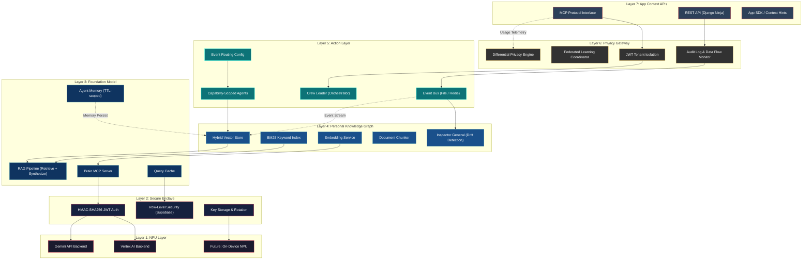

# Chapter 3: Technical Architecture --- The Flywheel OS Stack

> *"The flywheel OS requires a fundamentally different architecture than traditional operating systems. It's not a feature bolted onto Windows or macOS---it's a rethinking of what the kernel, the user space, and the application model are for."*
> --- Personal Data Flywheel OS Strategic Plan

---

## 3.1 Why Seven Layers

Traditional operating systems organize around a hardware abstraction layer, a kernel, and user space. The Flywheel OS breaks this contract. Its seven layers are not organized by privilege rings or memory protection boundaries---they are organized by *data trust boundaries*. Each layer answers a different question about what the system knows, who can access it, and what can be done with it.

The stack reads bottom-up from silicon to application, but the data flows in both directions: observations sink downward into storage and embeddings, while predictions and actions bubble upward toward the user. The flywheel's power comes from the tight coupling between these two flows---every action generates new observations, and every observation improves future actions.

```
Layer 7: App Context APIs          "What can apps see?"
Layer 6: Privacy Gateway            "What can leave the device?"
Layer 5: Action Layer               "What can the system do?"
Layer 4: Personal Knowledge Graph   "What does the system know?"
Layer 3: Foundation Model           "How does the system think?"
Layer 2: Secure Enclave             "Where is trust rooted?"
Layer 1: NPU Layer                  "What runs the inference?"
```

This is not an academic exercise. Every layer has shipping hardware or software precedents as of early 2026, and every layer has a direct analog in the ORCHA development platform that we use to build and test these patterns today.

---

## 3.2 The Seven Layers

### Layer 1: NPU Layer --- Dedicated Inference Hardware

**Purpose:** Provide dedicated neural processing capacity separate from the CPU and GPU, preventing inference workloads from contending with general computation and graphics rendering.

**Specification:**
- 40+ TOPS (trillion operations per second) sustained throughput
- Hardware-level encryption for model weights and personal data in transit
- Separate thermal budget from CPU/GPU to prevent throttling under sustained inference
- Direct memory path to Secure Enclave (Layer 2) without traversing main memory bus

**Current Precedents (Shipping 2025--2026):**

| Silicon | NPU TOPS | Architecture | Platform |
|---------|----------|-------------|----------|
| Apple M4 Neural Engine | 38 TOPS | 16-core dedicated | macOS, iPadOS |
| Qualcomm Hexagon NPU (X Elite) | 45 TOPS | Dedicated tensor cores | Windows on ARM |
| Intel Meteor Lake NPU | 11 TOPS | Integrated VPU | Windows, Linux |
| Google Tensor G4 | 33 TOPS* | Custom TPU-derived | Android (Pixel) |

*Estimated; Google does not publish discrete NPU TOPS for Tensor G-series.*

**Why Dedicated Silicon Matters:**
Running a 3B parameter model at interactive latency (< 200ms first token) requires sustained matrix multiplication throughput that would starve a general-purpose CPU. GPUs can handle it but at the cost of graphics performance and power budget. The NPU provides a third compute domain optimized specifically for transformer inference, with quantization-aware datapaths (INT4/INT8) that general silicon lacks.

**ORCHA Analog:** In ORCHA, inference runs via the **Brain MCP Server** (`mcp-servers/brain/`), which delegates to Vertex AI or Gemini API backends. The Brain server's backend selection logic---Vertex AI preferred, Gemini API fallback, graceful degradation to None---mirrors the NPU's role as a dedicated inference substrate. When ORCHA eventually runs on-device models, the Brain MCP interface remains stable; only the backend changes.

---

### Layer 2: Secure Enclave --- Hardware-Isolated Trust Root

**Purpose:** Provide hardware-isolated storage for personal embeddings, conversation history, and behavioral patterns. Cryptographically bound to device and biometric identity.

**Key Property:** Even the OS kernel cannot read raw personal data. Only the inference engine *running inside the enclave* can access it. This is not a software policy that can be bypassed by a privileged process---it is a hardware constraint enforced by the memory controller.

**Specification:**
- Isolated execution environment with its own boot ROM
- Hardware random number generator for cryptographic operations
- Secure key storage bound to device identity + biometric
- Encrypted memory bus between enclave and NPU
- Tamper detection with automatic key zeroization

**Current Precedents:**

| Technology | Vendor | Isolation Model |
|-----------|--------|----------------|
| Secure Enclave Processor | Apple | Separate L4 chip die with dedicated AES engine |
| Microsoft Pluton | AMD/Intel/Qualcomm | TPM integrated into SoC die |
| ARM TrustZone | ARM licensees | Hardware-partitioned secure/normal worlds |
| Google Titan M2 | Google | Discrete security chip |

**Trust Model:**
The Secure Enclave establishes a hardware root of trust for the entire flywheel. Personal embeddings are encrypted at rest with keys that never leave the enclave. When the Foundation Model (Layer 3) needs to query personal data, the query executes *inside the enclave boundary*---results are returned to the model, but raw vectors never traverse the unprotected memory bus.

**ORCHA Analog:** ORCHA implements tenant isolation through **Supabase Row-Level Security (RLS)** with **JWT-scoped tenant auth** (`orcha_moby/storage/supabase_auth.py`). Each tenant's data---embeddings, metadata, collection records---is cryptographically scoped via HMAC-SHA256 signed JWTs. The `SupabaseVectorStorage` class enforces that all queries include tenant context, preventing cross-tenant data access at the storage layer. This is a software approximation of the hardware isolation the Secure Enclave provides.

---

### Layer 3: Foundation Model --- On-Device Intelligence

**Purpose:** A 3--10B parameter language model optimized for device silicon, handling semantic search, text generation, image understanding, and behavioral prediction.

**Specification:**
- 3--10B parameters, quantized to 2--4 bit precision for efficiency
- Adapter layers (LoRA-style) personalized per-user without retraining the base model
- Multi-modal: text, image, structured data input
- Latency target: < 200ms time-to-first-token for interactive use
- Context window: 4K--8K tokens for on-device, cloud overflow for longer contexts

**Current Precedents:**

| Model | Parameters | Quantization | Platform |
|-------|-----------|-------------|----------|
| Apple AFM (Ajax Foundation Model) | ~3B on-device | 2-bit palletized | iOS 18+, macOS 15+ |
| Google Gemini Nano | 1.8B / 3.25B | INT4 | Android 14+ (Pixel, Samsung) |
| Microsoft Phi-Silica | ~3.3B | INT4 | Windows 11 (Copilot+) |
| Qualcomm AI Hub models | 1--7B | INT4/INT8 | Snapdragon X Elite |

**Personalization Without Retraining:**
The base model provides general intelligence. Per-user personalization happens through adapter layers (LoRA/QLoRA) that modify a small subset of model weights based on the user's interaction patterns. These adapters are stored in the Secure Enclave and loaded at inference time. When the user switches context (e.g., from work to personal), different adapter sets can be swapped in hundreds of milliseconds.

**ORCHA Analog:** The **Brain MCP Server** (`mcp-servers/brain/server.py`) serves as ORCHA's foundation model layer. It provides:
- **RAG-augmented inference**: Moby retrieval followed by LLM synthesis with source citations
- **Backend abstraction**: Vertex AI (preferred) > Gemini API > graceful None
- **Query caching**: Reduces redundant inference calls
- **Session-scoped memory**: Persistent agent memory with TTL, analogous to LoRA adapter state

The `BrainQuery` and `BrainResponse` models define the inference contract. The `query_brain` tool accepts natural language, retrieves relevant context from Moby, synthesizes an answer, and returns it with citations---the same observe-retrieve-reason-respond loop the Foundation Model layer performs.

---

### Layer 4: Personal Knowledge Graph --- The Flywheel's State

**Purpose:** A graph database of the user's entities, relationships, preferences, and temporal patterns. This is the flywheel's compounding state---the thing that gets more valuable with every interaction.

**Specification:**
- **Nodes:** People, projects, locations, documents, habits, preferences
- **Edges:** Relationships, frequencies, contexts, temporal patterns
- **Storage:** Hybrid---embedded graph for structure, vector indices for semantic search, full-text for keyword retrieval
- **Update cadence:** Continuous from observation layer
- **Versioning:** SCD Type 2 on all dimensions (every state change creates a new version)

**Current Precedents:**

| Technology | Role | Platform |
|-----------|------|----------|
| KuzuDB (embedded graph) | Relationship storage | Cross-platform |
| SQLite-FTS5 | Full-text keyword search | Cross-platform |
| pgvector / Faiss | Vector similarity search | Server / on-device |
| Apple Core Data + CloudKit | Structured personal data | Apple ecosystem |
| Google Knowledge Graph (server) | Entity relationships | Google services |

**Why the Knowledge Graph Is the Flywheel:**
Raw data (emails, messages, files, browsing history) is input. The knowledge graph is *derived state*---the system's understanding of what that data means. "User has 14 emails about Project X" is raw observation. "User is preparing for a critical client presentation on Friday, is stressed about the budget section, and prefers to work on presentations in the morning" is knowledge graph state. The graph compounds because new observations are interpreted *in the context of existing knowledge*, creating richer connections than any single observation could produce.

**ORCHA Analog:** **Moby RAG** (`packages/orcha-moby/`) is ORCHA's knowledge graph layer. It provides:

| Moby Component | Knowledge Graph Role |
|---------------|---------------------|
| `SupabaseVectorStorage` | Vector embeddings (semantic similarity) |
| `HybridVectorStore` | Hybrid search (vector + BM25 keyword) |
| `DocumentChunker` | Token-aware chunking (512 tokens, 50 overlap) |
| `EmbeddingService` | OpenAI-compatible embedding generation |
| `WikiPipeline` | Source ingestion: read > chunk > embed > store > search |
| `MobyIG` (Inspector General) | Drift detection, freshness monitoring, orphan cleanup |
| Collection/Bookmark/ReadingList | Structured entity relationships |

The `HybridVectorStore` combines vector similarity search with BM25 keyword matching, mirroring the knowledge graph's need for both semantic ("things related to this concept") and exact ("the email from Tuesday about budget") retrieval. Moby's collection-scoped search provides the equivalent of graph partitioning---each project, domain, or tenant gets its own searchable subgraph.

---

### Layer 5: Action Layer --- Multi-Agent Execution

**Purpose:** A multi-agent system that translates the Foundation Model's predictions into concrete actions. Agents have capability scopes, human-in-the-loop approval for high-stakes actions, and learned approval patterns that reduce friction over time.

**Specification:**
- **Agent scopes:** Each agent has a defined capability boundary (email, calendar, file system, code, browser)
- **Approval tiers:** Observe-only (no approval needed), low-risk (auto-approved after learning period), high-risk (always requires human confirmation)
- **Learning:** Approval patterns are fed back into the knowledge graph, gradually reducing prompt fatigue
- **Orchestration:** Leader-worker pattern for complex multi-step tasks

**Current Precedents:**

| Technology | Approach | Platform |
|-----------|----------|----------|
| Apple App Intents | Structured action declarations | iOS/macOS |
| Android Gemini Actions | LLM-routed app actions | Android 15+ |
| MCP (Model Context Protocol) | Tool-use protocol for LLM agents | Cross-platform |
| Claude Code / Cursor | Code-domain agent actions | Developer tools |

**ORCHA Analog:** The **Agent Harness** (`harness/src/agent_harness/`) is ORCHA's action layer:

| Harness Component | Action Layer Role |
|------------------|-------------------|
| `CrewLeaderHarness` | Multi-agent orchestration, task delegation |
| `FileEventBus` / `RedisBus` | Event publish/subscribe for agent communication |
| `EventRoutingConfig` | Route events to appropriate handler agents |
| Agent profiles (`config/agents/*.yaml`) | Capability-scoped agent definitions |
| `orcha-crew` CLI | Crew lifecycle management (leader + workers) |
| `orcha-launch` CLI | Parallel worker spawning |
| CAO (CLI Agent Orchestrator) | Terminal-level agent handoff and delegation |

The `EventBus` protocol defines `publish()` and `subscribe()` methods with two implementations: `FileEventBus` for local development (JSONL files) and `RedisBus` for distributed deployments. The `ORCHA_BUS_BACKEND=auto|redis|file` environment variable selects the backend, mirroring how the Action Layer must adapt to different deployment contexts (on-device vs. cloud-assisted).

The crew pattern---a `CrewLeaderHarness` that delegates to specialized workers via tmux sessions---directly maps to the Flywheel OS's multi-agent architecture where a central orchestrator routes tasks to capability-scoped agents.

---

### Layer 6: Privacy Gateway --- Controlled Data Egress

**Purpose:** All cloud requests pass through the Privacy Gateway. Differential privacy is applied to any data leaving the device. Federated learning enables model improvement without raw data sharing. All computation is auditable.

**Specification:**
- **Differential privacy:** Noise injection on all outbound data with configurable epsilon
- **Federated learning:** On-device gradient computation, only aggregated updates shared
- **Auditable computation:** Cryptographic attestation of cloud workloads (Apple PCC model)
- **Data flow logs:** User-readable audit trail of what data left the device, when, and why
- **Kill switch:** User can disable all cloud communication instantly

**Current Precedents:**

| Technology | Privacy Model | Vendor |
|-----------|--------------|--------|
| Apple Private Cloud Compute (PCC) | Stateless cloud nodes, cryptographic attestation | Apple |
| On-device differential privacy | Local DP with randomized response | Apple, Google |
| Federated learning | Gradient aggregation without raw data | Google (Gboard), Apple |
| Android Private Compute Core | Isolated process, no direct network access | Google |

**ORCHA Analog:** ORCHA implements privacy controls through multiple layers:

| ORCHA Component | Privacy Gateway Role |
|----------------|---------------------|
| JWT tenant auth (`supabase_auth.py`) | Cryptographic tenant isolation |
| Supabase RLS policies | Row-level data access control |
| `SupabaseConfig` (pydantic-settings) | Environment-driven secrets, no hardcoded credentials |
| Brain MCP query caching | Reduces data egress by caching repeated queries |
| Agent Harness permission model | Agents require explicit capability grants |
| MobyIG audit trail | Tracks what was indexed, when, and from where |

The tenant JWT system (`create_tenant_jwt()`) generates HMAC-SHA256 signed tokens that scope every database query to a specific tenant. Supabase RLS policies enforce this at the database level---even if application code has a bug, the database will not return cross-tenant data. This mirrors the Privacy Gateway's principle that data isolation should be enforced at a layer below application logic.

---

### Layer 7: App Context APIs --- Structured Access to Intelligence

**Purpose:** Applications access personal context through structured APIs---never raw data. The OS provides "contextual hints" (e.g., "user is preparing for a meeting with X about Y") without exposing underlying personal data. Apps compete on what they do with context, not on hoarding data.

**Specification:**
- **Contextual hints:** Pre-computed, privacy-safe summaries of user context
- **Capability-based access:** Apps declare what context types they need; users approve
- **No raw data access:** Apps cannot query the knowledge graph directly
- **Standardized schemas:** Common formats for calendar context, communication context, project context, etc.
- **Rate limiting:** Prevents context API abuse

**Current Precedents:**

| Technology | API Model | Vendor |
|-----------|----------|--------|
| Apple Foundation Models framework | Structured access to on-device intelligence | Apple |
| Android AI Core | OS-level AI service APIs | Google |
| Windows Copilot Runtime | Semantic API for app context | Microsoft |
| MCP (Model Context Protocol) | Structured tool-use interface | Anthropic |

**ORCHA Analog:** ORCHA's **MCP Server architecture** is the direct equivalent of App Context APIs:

| ORCHA Component | App Context API Role |
|----------------|---------------------|
| Brain MCP `query_brain` tool | Natural language context queries |
| Brain MCP `search_code` / `search_symbol` | Structured code context |
| Moby MCP `search_specs` | Documentation context |
| Moby MCP `search_all_tenants` | Cross-domain context search |
| Analytics API (`orcha-analytics`) | Pre-aggregated operational metrics |
| Django Ninja routers | RESTful structured access to analytics |

The MCP protocol is particularly significant here. It defines a structured interface where agents (applications) declare tools they can use, and the server (OS) provides context through those tools. The agent never sees raw embeddings or database rows---it receives synthesized answers with citations. This is exactly the App Context API pattern: structured access to intelligence without raw data exposure.

---

## 3.3 ORCHA Mapping Table

The following table maps each Flywheel OS layer to its ORCHA equivalent, including the specific source paths and key interfaces.

| # | Flywheel OS Layer | ORCHA Component | Source Path | Key Interface |
|---|------------------|----------------|-------------|---------------|
| 1 | **NPU Layer** | Brain MCP backend selection | `mcp-servers/brain/server.py` | Vertex AI / Gemini API backends |
| 2 | **Secure Enclave** | Supabase tenant JWT + RLS | `packages/orcha-moby/src/orcha_moby/storage/supabase_auth.py` | `create_tenant_jwt()`, RLS policies |
| 3 | **Foundation Model** | Brain MCP Server | `mcp-servers/brain/` | `query_brain`, `search_code`, `search_symbol` |
| 4 | **Personal Knowledge Graph** | Moby RAG | `packages/orcha-moby/` | `HybridVectorStore`, `WikiPipeline`, `MobyIG` |
| 5 | **Action Layer** | Agent Harness + Event Bus | `harness/src/agent_harness/` | `CrewLeaderHarness`, `EventBus`, `EventRoutingConfig` |
| 6 | **Privacy Gateway** | Tenant isolation + config security | `packages/orcha-moby/src/orcha_moby/storage/` | JWT auth, RLS, pydantic-settings |
| 7 | **App Context APIs** | MCP Server tools + Analytics API | `mcp-servers/`, `packages/orcha-analytics/` | MCP tools, Django Ninja routers |

---

## 3.4 Component Interaction Matrix

This matrix shows how each layer communicates with every other layer. Arrows indicate data flow direction; cells describe the interaction type.

| | L1 NPU | L2 Enclave | L3 Foundation | L4 Knowledge | L5 Action | L6 Privacy | L7 App APIs |
|---|--------|-----------|--------------|-------------|----------|-----------|------------|
| **L1 NPU** | --- | Encrypted memory bus | Inference execution | Embedding generation | --- | --- | --- |
| **L2 Enclave** | Hardware trust | --- | Key provisioning | Vector encryption | --- | Attestation | --- |
| **L3 Foundation** | Compute substrate | Secure weights | --- | RAG retrieval | Action planning | Query filtering | Synthesized responses |
| **L4 Knowledge** | Embedding compute | Encrypted storage | Semantic queries | --- | Context for agents | Privacy filtering | Contextual hints |
| **L5 Action** | --- | --- | Inference requests | Graph updates | --- | Egress control | Tool execution |
| **L6 Privacy** | --- | Key management | DP noise injection | Access audit | Approval gates | --- | Rate limiting |
| **L7 App APIs** | --- | --- | Context queries | --- | Action requests | Consent management | --- |

**Critical Paths:**
- **Observation loop:** L7 (app event) -> L5 (agent processes) -> L4 (graph update) -> L2 (encrypted store)
- **Prediction loop:** L4 (graph query) -> L3 (inference) -> L1 (NPU compute) -> L5 (action proposal) -> L7 (app display)
- **Privacy loop:** L5 (outbound request) -> L6 (privacy check) -> L2 (attestation) -> external cloud

---

## 3.5 Architecture Diagram



---

## 3.6 Hardware Requirements Per Layer

The Flywheel OS makes explicit hardware demands that traditional operating systems do not. The following table specifies minimum and recommended requirements for each layer.

| Layer | Component | Minimum | Recommended | Notes |
|-------|----------|---------|-------------|-------|
| **L1: NPU** | Neural processing unit | 11 TOPS (Intel NPU) | 40+ TOPS (Apple M4, Snapdragon X) | Below 11 TOPS, cloud offload required for interactive latency |
| **L1: NPU** | NPU memory bandwidth | 16 GB/s shared | 64+ GB/s dedicated | Shared bandwidth causes inference jitter |
| **L2: Enclave** | Secure processor | TPM 2.0 | Integrated SoC enclave (Apple SEP, Pluton) | Discrete TPM adds latency; SoC integration preferred |
| **L2: Enclave** | Secure storage | 256 MB | 1 GB+ | Stores encrypted embeddings, adapter weights |
| **L3: Foundation** | System RAM | 8 GB (after OS) | 16+ GB unified | 3B model at INT4 requires ~2 GB; 7B requires ~4 GB |
| **L3: Foundation** | Model storage | 4 GB | 16 GB | Base model + multiple LoRA adapters |
| **L4: Knowledge** | Vector storage | 1 GB SSD | 10+ GB NVMe | 100K embeddings at 1536 dimensions ~= 600 MB |
| **L4: Knowledge** | Graph/FTS index | 512 MB | 2+ GB | Scales with entity count and relationship density |
| **L5: Action** | CPU cores | 4 cores | 8+ cores | Multi-agent concurrency requires parallel threads |
| **L5: Action** | Event bus I/O | SSD (any) | NVMe (low-latency) | File-based event bus is I/O bound |
| **L6: Privacy** | Crypto acceleration | Software AES | Hardware AES-NI | JWT signing, DP noise generation |
| **L7: App APIs** | Network | Optional | Always-on broadband | Offline-capable for Layers 1--5; L7 cloud features need network |

**Total System Minimum:** 16 GB RAM, 128 GB SSD, NPU-capable SoC, TPM 2.0
**Recommended:** 32 GB unified RAM, 512 GB NVMe, 40+ TOPS NPU, integrated secure enclave

**ORCHA Development Requirements:**
For developing and testing against the ORCHA stack (which simulates all seven layers in software):

| Resource | Minimum | Notes |
|----------|---------|-------|
| RAM | 8 GB | Brain MCP + Moby + Agent Harness |
| Storage | 10 GB | Supabase pgvector + SQLite metadata + event logs |
| CPU | 4 cores | Parallel agent spawning via tmux |
| Network | Required | Supabase cloud, Vertex AI / Gemini API |
| Python | 3.11+ | asyncpg, pydantic v2, tiktoken |

---

## 3.7 Reference Implementations

Each Flywheel OS layer has reference implementations in ORCHA that can be studied, tested, and extended. The following table provides direct entry points.

### Layer 1 & 3: Inference (Brain MCP)

```python
# Brain MCP server entry point
# mcp-servers/brain/server.py

# Backend selection: Vertex AI > Gemini API > None
from brain.models import BrainQuery, BrainResponse

# Query with RAG-augmented inference
result = await query_brain(
    query="How does the event bus work?",
    max_results=5,
    include_memory=True,
    search_strategy="hybrid",  # vector + BM25
)
# Returns: answer with source citations
```

### Layer 2 & 6: Security (Tenant JWT + RLS)

```python
# Tenant-scoped JWT generation
# packages/orcha-moby/src/orcha_moby/storage/supabase_auth.py

from orcha_moby import create_tenant_jwt

token = create_tenant_jwt(
    tenant_id="yardsage",
    secret="your-jwt-secret",
)
# Token contains: {"tenant_id": "yardsage", "role": "authenticated"}
# Supabase RLS policies filter all queries by tenant_id claim
```

### Layer 4: Knowledge Graph (Moby RAG)

```python
# Hybrid search: vector similarity + BM25 keyword
# packages/orcha-moby/src/orcha_moby/rag/storage/hybrid_store.py

from orcha_moby.rag.storage.hybrid_store import HybridVectorStore

store = HybridVectorStore(config)
await store.connect()

# Ingest documents into knowledge graph
from orcha_moby import WikiPipeline, DocumentChunker, EmbeddingService
pipeline = WikiPipeline(
    vector_storage=store,
    embedding_service=EmbeddingService(),
    chunker=DocumentChunker(),  # 512 tokens, 50 overlap
    collection_id="project-docs",
)
stats = await pipeline.ingest(documents)

# Semantic search with hybrid retrieval
results = await store.search(
    query_embedding=embedding,
    collection_id="project-docs",
    limit=10,
)
```

### Layer 4: Knowledge Freshness (MobyIG)

```python
# Inspector General: drift detection and sync
# packages/orcha-moby/src/orcha_moby/ig/service.py

from orcha_moby import MobyIG, MobyIGConfig
from pathlib import Path

config = MobyIGConfig(target_path=Path("/my/project"))
ig = MobyIG(library=lib, config=config)

# Check freshness: SYNCED | STALE | MISSING | ORPHANED
report = await ig.status()
# Sync stale/missing documents
if not report.is_clean:
    result = await ig.sync()
```

### Layer 5: Action Layer (Agent Harness)

```python
# Event Bus: publish/subscribe for agent communication
# harness/src/agent_harness/events/file_bus.py

from agent_harness.events import FileEventBus, Event

bus = FileEventBus(path="~/.orcha/events")
event = Event(
    event_type="task.completed",
    source="worker-agent-001",
    payload={"task_id": "ORCHA-123", "status": "success"},
)
bus.publish(event)

# Crew orchestration
# harness/src/agent_harness/crew/leader_harness.py
# CrewLeaderHarness delegates to workers via tmux sessions
```

### Layer 7: App Context APIs (Analytics + MCP)

```python
# CI Health API endpoint
# packages/orcha-analytics/src/orcha_analytics/api/ci.py

from orcha_analytics.services.ci_health import CIHealthService

service = CIHealthService()
health = service.get_daily_health(days=7, workflow_name="ORCHA Tests")
# Returns: CIHealthResponse with daily_metrics, total_runs, overall_pass_rate

failures = service.get_recent_failures(limit=10)
# Returns: CIRecentFailuresResponse with failure details
```

---

## 3.8 What ORCHA Proves and What It Cannot

ORCHA is not a Flywheel OS. It is a development platform that implements *software analogs* of each Flywheel OS layer. This distinction matters.

**What ORCHA validates:**
- The seven-layer decomposition is architecturally coherent---each layer has clean interfaces and can evolve independently
- Hybrid retrieval (vector + keyword) is essential for a useful knowledge graph---pure vector search misses exact matches; pure keyword search misses semantic relationships
- Multi-agent orchestration requires both synchronous (crew delegation) and asynchronous (event bus) communication patterns
- Tenant isolation at the storage layer (JWT + RLS) is a viable software proxy for hardware enclave isolation
- Knowledge freshness monitoring (MobyIG drift detection) is non-negotiable---stale embeddings degrade the flywheel

**What ORCHA cannot validate:**
- Hardware NPU performance under sustained inference load
- Secure Enclave cryptographic guarantees (ORCHA uses software JWT, not hardware isolation)
- On-device model latency with real 3B parameter models
- Differential privacy noise calibration for personal data
- Federated learning convergence with heterogeneous device populations
- User trust dynamics over months of flywheel operation

The gap between ORCHA's software simulation and the Flywheel OS's hardware-rooted architecture is precisely where the engineering challenges lie. Brain MCP can switch backends seamlessly because it was designed for it. The real NPU layer will need the same abstraction but with microsecond-level latency constraints that cloud API calls cannot simulate.

---

## Summary

The Flywheel OS stack is seven layers of trust, intelligence, and action---each building on the one below, each feeding observations back to compound the system's understanding. The NPU provides compute. The Secure Enclave provides trust. The Foundation Model provides reasoning. The Knowledge Graph provides memory. The Action Layer provides agency. The Privacy Gateway provides consent. The App Context APIs provide access.

ORCHA implements every layer in software: Brain MCP for inference, Moby RAG for knowledge, the Agent Harness for action, JWT/RLS for security, and MCP tools for structured access. These are not toys---they are production systems processing 12,000+ code chunks across multiple tenants with hybrid retrieval, real-time drift detection, and multi-agent orchestration.

The architecture works. The flywheel spins. What remains is moving from software simulation to silicon reality.
