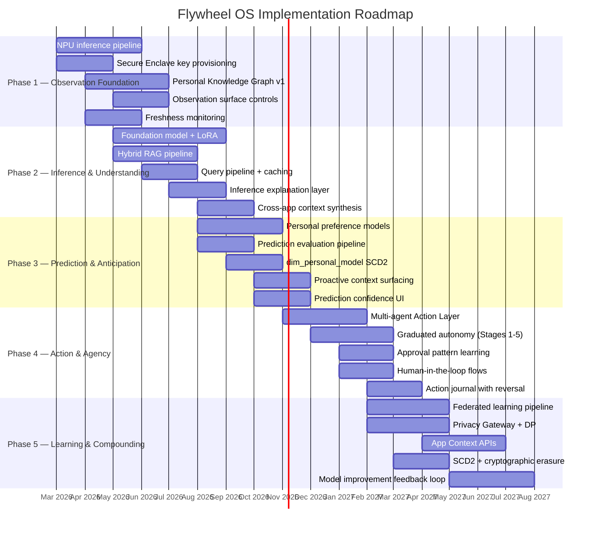

# Chapter 7 --- Implementation Roadmap

> *"Phased approach mapped to flywheel stages. Each phase is independently valuable---the flywheel doesn't require all stages to deliver value, but each stage amplifies the others."*
> --- Personal Data Flywheel OS Strategic Plan

---

The previous chapters described *what* the Flywheel OS is: a seven-layer technical architecture (Chapter 3), a Kimball dimensional model that tracks personal model evolution (Chapter 4), and a trust architecture that determines whether the flywheel spins or stalls (Chapter 6). This chapter describes *when* and *in what order* to build it.

Implementation order matters more than most architects admit. A flywheel that ships Stage 4 (Act) before Stage 1 (Observe) is mature enough will take autonomous actions based on a weak model of the user---the Apple Intelligence credibility gap, repeated at scale. A flywheel that perfects Stage 1 for two years before shipping any user-facing value will die of irrelevance. The roadmap must balance two constraints: each phase must deliver independent value on its own timeline, and each phase must lay the foundation for the next.

ORCHA's development history provides empirical evidence for which order works. Over the past year, ORCHA shipped Brain MCP, Moby RAG, the Agent Harness, tenant isolation, and multi-agent orchestration---roughly Phases 1 through 4 of this roadmap, implemented in software. The sequence was not accidental. It was the order that worked.

---

## 7.1 Phasing Principles

Three principles govern the phasing strategy.

**Principle 1: Each phase is independently valuable.** A user who never progresses past Phase 1 (Observation Foundation) still has a personal knowledge graph that organizes their digital life. A user who reaches Phase 3 (Prediction) but never enables Phase 4 (Action) still receives anticipatory suggestions that save time daily. The flywheel does not require all five stages to deliver value---but each stage amplifies the others.

**Principle 2: Each phase unlocks the next flywheel stage.** The five phases map directly to the five flywheel stages defined in Chapter 2:

| Phase | Flywheel Stage | Core Question |
|-------|---------------|---------------|
| Phase 1: Observation Foundation | Stage 1: Observe | Can the system see? |
| Phase 2: Inference & Understanding | Stage 2: Infer | Can the system think? |
| Phase 3: Prediction & Anticipation | Stage 3: Predict | Can the system anticipate? |
| Phase 4: Action & Agency | Stage 4: Act | Can the system do? |
| Phase 5: Learning & Compounding | Stage 5: Learn | Can the system improve? |

A phase cannot succeed if the previous phase's foundation is weak. Inference without observation produces hallucinations. Prediction without inference produces noise. Action without prediction produces chaos. The phases are ordered by dependency, not by difficulty.

**Principle 3: Phases overlap.** The timeline is not sequential waterfall. Phase 2 begins before Phase 1 completes, because early inference work informs what the observation layer needs to capture. Phase 4 prototyping starts during Phase 3, because the action layer's approval patterns require prediction-quality data to test against. The Gantt chart in Section 7.7 shows the overlaps explicitly.

---

## 7.2 Phase 1: Observation Foundation (Months 1--4)

*The system learns to see.*

Phase 1 builds the infrastructure that makes the flywheel possible: the hardware inference pipeline, the security foundation, and the initial personal knowledge graph. Nothing in this phase is user-facing in the traditional sense---the user does not interact with predictions or actions. Instead, the system silently builds a model of the user's digital life, earning the right to do more later.

### Deliverables

| # | Deliverable | Description | Success Metric |
|---|-------------|-------------|----------------|
| 1.1 | NPU inference pipeline | Deploy on-device model execution with INT4/INT8 quantization on target silicon (Apple M4, Snapdragon X Elite, Intel Meteor Lake) | First-token latency < 200ms for 3B model |
| 1.2 | Secure Enclave key provisioning | Implement hardware-bound key generation, biometric binding, and encrypted memory bus between enclave and NPU | Zero key exposure in penetration testing |
| 1.3 | Personal Knowledge Graph v1 | Entity extraction from email, calendar, and file activity. Relationship mapping between people, projects, and topics | > 500 entities extracted per active user after 14 days |
| 1.4 | Observation surface controls | Per-category opt-in/opt-out UI. Real-time observation pause/resume. Category-level data deletion | User can disable any observation category in < 3 taps |
| 1.5 | Freshness monitoring | Automated drift detection for indexed content. Stale-document identification and re-indexing triggers | < 24 hours between source change and graph update |

### Architecture Focus

Phase 1 exercises Layers 1, 2, and 4 of the Flywheel OS stack (Chapter 3). The NPU pipeline (Layer 1) provides inference capacity. The Secure Enclave (Layer 2) provides the trust root. The Personal Knowledge Graph (Layer 4) provides the compounding state.

The critical integration is the encrypted memory path between the NPU and the Secure Enclave. Raw personal data---email content, file text, calendar details---must travel from the observation layer through the embedding model and into the encrypted graph store without ever existing in plaintext in main memory. This is the architectural constraint that Microsoft Recall violated and that this phase must satisfy.

### ORCHA Today

ORCHA's existing codebase already implements the software analog of Phase 1:

- **Brain MCP** (`mcp-servers/brain/server.py`) provides the inference pipeline with backend abstraction (Vertex AI, Gemini API, graceful fallback). The `query_brain` tool demonstrates the retrieve-reason-respond loop that the NPU pipeline will execute on-device.
- **Moby RAG ingestion** (`packages/orcha-moby/src/orcha_moby/rag/ingestion/pipeline.py`) performs entity extraction through document chunking, embedding generation, and vector storage---the same pipeline the observation layer uses to build the knowledge graph.
- **MobyIG drift detection** (`packages/orcha-moby/src/orcha_moby/ig/`) monitors freshness with SYNCED/STALE/MISSING/ORPHANED status tracking, directly analogous to Deliverable 1.5.
- **Supabase tenant JWT** (`packages/orcha-moby/src/orcha_moby/storage/`) provides the software approximation of enclave-scoped isolation via HMAC-SHA256 signed tokens and Row-Level Security policies.

The gap between ORCHA and Phase 1 is hardware: ORCHA runs inference in the cloud and stores vectors in Supabase. Phase 1 moves both onto the device, behind a hardware security boundary.

### Phase 1 Exit Criteria

Phase 1 is complete when the following conditions are met simultaneously:

1. The NPU pipeline can execute a 3B quantized model with < 200ms first-token latency on at least one target silicon family.
2. The Secure Enclave holds user-bound keys and the NPU-to-enclave memory path is encrypted end-to-end.
3. The Personal Knowledge Graph contains > 500 entities for test users after 14 days of observation.
4. Freshness monitoring detects source changes within 24 hours and triggers re-indexing automatically.
5. Users can disable any observation category without data loss in other categories.

If any criterion is not met, Phase 2 work on inference and personalization proceeds on the existing cloud backend while Phase 1 hardware integration continues in parallel. The architecture must support this fallback: the Brain MCP pattern of backend abstraction (Vertex AI > Gemini API > None) is the template.

---

## 7.3 Phase 2: Inference & Understanding (Months 3--7)

*The system learns to think.*

Phase 2 upgrades the system from passive observation to active understanding. The knowledge graph built in Phase 1 becomes queryable---the user can ask questions about their own data and receive synthesized answers. The foundation model gains LoRA-style personalization, adapting its reasoning to the user's vocabulary, domain, and communication patterns.

### Deliverables

| # | Deliverable | Description | Success Metric |
|---|-------------|-------------|----------------|
| 2.1 | Foundation model with LoRA personalization | Deploy 3B base model with per-user adapter layers trained from observation history. Adapter swap in < 500ms for context changes | Personalized model outperforms base model on user-specific queries by > 20% |
| 2.2 | Hybrid RAG pipeline | Vector similarity search (pgvector/Faiss) combined with BM25 keyword retrieval for knowledge graph queries | Recall@10 > 85% on user's own document corpus |
| 2.3 | Query pipeline with caching | Natural language queries against the personal knowledge graph with result caching and TTL-based invalidation | Median query latency < 500ms; cache hit rate > 40% after 7 days |
| 2.4 | Inference explanation layer | Human-readable explanations for why the system drew a specific conclusion from the knowledge graph | > 80% of explanations rated "helpful" or "accurate" in user testing |
| 2.5 | Cross-app context synthesis | Combine observations from multiple apps into unified understanding (e.g., "meeting with Alice about Project X" from calendar + email + document activity) | > 70% of cross-app inferences validated as correct by user |

### Architecture Focus

Phase 2 exercises Layer 3 (Foundation Model) and deepens Layer 4 (Knowledge Graph). The hybrid retrieval strategy---combining dense vector search for semantic similarity with sparse BM25 for exact keyword matching---is not optional. Pure vector search misses exact names, dates, and identifiers. Pure keyword search misses semantic relationships. The hybrid approach is how the system answers both "emails about the budget discussion" and "messages from Sarah last Tuesday."

The LoRA personalization layer is the first flywheel-specific technology in the stack. The base model provides general intelligence; the adapter layers encode what makes *this user's* world different from the general case. Adapter weights are small (typically 1--5% of base model parameters), stored in the Secure Enclave, and swappable at inference time.

### ORCHA Today

Phase 2 maps closely to ORCHA's shipped capabilities:

- **HybridVectorStore** (`packages/orcha-moby/src/orcha_moby/rag/storage/hybrid_store.py`) implements the hybrid search strategy, combining pgvector similarity with BM25 keyword matching over Supabase. This is the exact architecture Deliverable 2.2 requires.
- **Brain MCP `query_brain`** (`mcp-servers/brain/server.py`) provides natural language queries with RAG-augmented synthesis, source citations, and confidence scoring---Deliverable 2.3 in production.
- **Brain MCP `cache_stats`** exposes cache hit rates and TTL management, demonstrating the caching layer described in Deliverable 2.3.
- **Agent memory** (`harness/src/agent_harness/memory.py`) provides session-scoped persistent context that functions as a lightweight analog to LoRA personalization: the agent's behavior adapts based on accumulated session history.

ORCHA ingested 1,112 files into 12,557 chunks across multiple tenants using this exact pipeline (PR #218). The hybrid retrieval works. The missing piece is on-device LoRA training---ORCHA personalizes through RAG context injection rather than weight adaptation.

### Phase 2 Exit Criteria

Phase 2 is complete when:

1. The personalized model (base + LoRA adapter) outperforms the base model by > 20% on user-specific evaluation queries.
2. Hybrid RAG achieves Recall@10 > 85% on the user's own document corpus.
3. Query latency median is < 500ms with cache hit rates > 40% after one week of use.
4. Cross-app context synthesis produces inferences validated as correct by > 70% of test users.
5. At least three explanation templates ("You seem to be working on X because...") are rated helpful by > 80% of testers.

The inference explanation layer (Deliverable 2.4) is the bridge to Phase 3. If users cannot understand *why* the system drew a conclusion, they will not trust the predictions that follow. Explanations must be concise (one sentence), grounded (citing specific observations), and dismissible (one tap to say "that is wrong").

---

## 7.4 Phase 3: Prediction & Anticipation (Months 6--10)

*The system learns to anticipate.*

Phase 3 is the phase where the flywheel first becomes *visibly useful* to the user. The system surfaces predictions---what the user will need, when they will need it, and what context is relevant---before the user asks. This is the transition from tool (user pulls) to assistant (system pushes). Getting predictions wrong erodes trust faster than getting them right builds it, so Phase 3 requires rigorous accuracy tracking.

### Deliverables

| # | Deliverable | Description | Success Metric |
|---|-------------|-------------|----------------|
| 3.1 | Personal preference models | Train per-user preference models from Phase 1 observation history: time-of-day patterns, communication preferences, workflow sequences | > 70% prediction acceptance rate within 30 days |
| 3.2 | Prediction evaluation pipeline | Automated accuracy tracking via `fact_flywheel_engagement` (Chapter 5). A/B testing framework for prediction strategies. Confidence calibration | Calibration error < 10% (predicted 80% confidence = 80% actual accuracy) |
| 3.3 | `dim_personal_model` SCD2 versioning | Production deployment of the SCD2 dimension table (Chapter 4) with batch materialization, hash-based change detection, and point-in-time queries | < 3 SCD2 rows per user per week; point-in-time queries return in < 50ms |
| 3.4 | Proactive context surfacing | Lock screen and notification-level predictions: pre-fetched meeting context, anticipated file needs, deadline awareness | > 60% of surfaced predictions acted upon |
| 3.5 | Prediction confidence UI | Visual confidence indicators on all predictions. "Why did you predict this?" explanations. One-tap dismissal with implicit feedback | Dismissal rate < 30% after 14 days of calibration |

### Architecture Focus

Phase 3 is where the dimensional model from Chapter 4 becomes load-bearing. Every prediction is a row in `fact_flywheel_engagement`. Every model update that changes prediction behavior triggers an SCD2 version bump in `dim_personal_model`. The batch materialization pattern---continuous event ingestion, periodic hash comparison, new SCD2 row only on change---keeps the dimension manageable while preserving full temporal auditability.

The prediction evaluation pipeline is the flywheel's quality control system. Without it, the system cannot distinguish between predictions that work and predictions that annoy. The `fact_flywheel_engagement` table records whether each prediction was acted upon, dismissed, or ignored, creating the feedback signal that Phase 5 (Learning) will consume.

### ORCHA Today

- **Agent memory and session-scoped learning** in Brain MCP demonstrate the core pattern: the system's behavior adapts based on accumulated interaction history. Brain MCP remembers context across queries within a session, producing increasingly relevant responses---the same dynamic that per-user preference models exploit.
- **SCD2 analytics** (`harness/src/agent_harness/analytics/`) already implement the dimensional modeling patterns described in Chapter 4. The `DimensionMember` model supports `is_current`, `effective_date`, and `expiration_date` fields. Deploying `dim_personal_model` extends an existing pattern, not introducing a new one.
- **Moby collection-scoped search** provides the per-user, per-project knowledge partitioning that prediction models need to avoid cross-contamination between domains.

The gap is explicit prediction surfacing. ORCHA's Brain MCP provides answers when asked; it does not proactively suggest what the user might need next. Phase 3 adds the push layer.

### Phase 3 Exit Criteria

Phase 3 is complete when:

1. Prediction acceptance rate exceeds 60% across all test users after 30 days.
2. Confidence calibration error is below 10%---when the system says "80% confident," it is correct 80% of the time.
3. The `dim_personal_model` SCD2 table is in production with batch materialization generating < 3 rows per user per week.
4. At least one proactive surfacing channel (lock screen, notification, or dashboard widget) is shipping with > 60% act-on rate.
5. The `fact_flywheel_engagement` pipeline records all prediction outcomes (accepted, dismissed, ignored) for downstream learning.

Phase 3 is the last phase that operates without autonomy. Everything the system does in Phase 3 is a suggestion that the user can ignore. Phase 4 changes this relationship fundamentally, which is why Phase 3's accuracy data must be robust before Phase 4 begins.

---

## 7.5 Phase 4: Action & Agency (Months 9--14)

*The system learns to act.*

Phase 4 is the most trust-sensitive phase. The system transitions from suggesting to doing---from "here is what you might need" to "I have done this on your behalf." Every principle from Chapter 6 (Trust Architecture) becomes load-bearing here. Graduated autonomy is not a nice-to-have; it is the mechanism that prevents the flywheel from destroying the trust it spent three phases building.

### Deliverables

| # | Deliverable | Description | Success Metric |
|---|-------------|-------------|----------------|
| 4.1 | Multi-agent Action Layer | Deploy capability-scoped agents (email, calendar, file system, code, browser) with defined permission boundaries per agent | Zero cross-scope capability leaks in security audit |
| 4.2 | Graduated autonomy (Stages 1--5) | Implement the five-stage trust graduation model from Chapter 6. Stage advancement requires sustained accuracy at current level. Stage regression on trust violations | Average time to Stage 3: 30 days. Stage 4: 90 days |
| 4.3 | Approval pattern learning | System learns which actions the user always approves and offers to automate them. Never escalates autonomy without explicit permission | Auto-approval accuracy > 95% after 60 days |
| 4.4 | Human-in-the-loop confirmation flows | Tiered confirmation UI: low-risk actions show post-hoc notification, medium-risk show 30-second undo window, high-risk require explicit approval | Confirmation fatigue score < 3 prompts/hour at steady state |
| 4.5 | Action journal with reversal | Every autonomous action records pre-state, post-state, and inverse operation. One-click undo for all actions within the graduated undo window (Section 6.6) | 100% of actions reversible within their undo window |

### Architecture Focus

Phase 4 exercises Layer 5 (Action Layer) of the Flywheel OS stack. The multi-agent architecture uses the leader-worker pattern: a central orchestrator receives the user's intent (or the prediction layer's anticipated intent), decomposes it into capability-scoped subtasks, and delegates to specialized agents. Each agent operates within a defined permission boundary---the email agent cannot modify files; the calendar agent cannot send messages.

The graduated autonomy system tracks its state in `dim_personal_model.autonomy_stage`. Stage transitions are SCD2 events: when a user advances from Stage 3 (Predict) to Stage 4 (Act with Approval), a new dimension row is created. Stage regressions---triggered by unauthorized actions, trust violations, or user request---are equally tracked. The full history of the trust relationship is preserved.

### ORCHA Today

Phase 4 is the phase where ORCHA's existing architecture provides the strongest validation:

- **Agent Harness** (`harness/src/agent_harness/`) implements the multi-agent orchestration layer with `CrewLeaderHarness` for task delegation and specialized worker agents for execution.
- **EventBus** (`harness/src/agent_harness/events/`) provides the publish/subscribe communication layer with two backends: `FileEventBus` (JSONL) for local development and `RedisBus` for distributed deployments. The `ORCHA_BUS_BACKEND=auto|redis|file` environment variable selects the backend.
- **Crew orchestration** (`harness/src/agent_harness/crew/`) implements the leader-worker pattern with tmux-based worker spawning, session lifecycle management, and event-driven coordination.
- **Agent profiles** (`config/agents/*.yaml`) define capability-scoped agent configurations---each agent has a role, tools, and behavioral constraints, directly analogous to the Action Layer's permission boundaries.
- **EventRoutingConfig** routes events to appropriate handler agents, implementing the capability-based routing that the Action Layer requires.

ORCHA has shipped 13 features in parallel using the meta-ralph manifest system (PRs #149--#161), orchestrated by a crew leader delegating to isolated workers. This is Phase 4 in operation---multi-agent coordination with scoped capabilities, event-driven communication, and orchestrated execution. The missing piece is user-facing graduated autonomy: ORCHA's agents operate with developer-granted trust, not end-user-earned trust.

### Phase 4 Exit Criteria

Phase 4 is complete when:

1. At least five capability-scoped agents (email, calendar, file system, code, browser) are deployed with zero cross-scope capability leaks.
2. The graduated autonomy system tracks `dim_personal_model.autonomy_stage` with SCD2 versioning. Average time to Stage 3 is 30 days; Stage 4 is 90 days.
3. Auto-approval accuracy exceeds 95% after 60 days---the system correctly predicts which actions the user will approve without asking.
4. Confirmation fatigue is below 3 prompts per hour at steady state.
5. 100% of autonomous actions are reversible within their designated undo window, verified by integration testing against the action journal.

Phase 4 produces the outcome data that Phase 5 needs: approval/rejection signals, action reversal frequency, autonomy stage transitions, and user engagement patterns. Without this data, the Phase 5 feedback loop has nothing to learn from.

---

## 7.6 Phase 5: Learning & Compounding (Months 12--18)

*The flywheel achieves self-sustaining momentum.*

Phase 5 closes the loop. The system takes everything it learned from Phases 1--4---observation accuracy, inference quality, prediction calibration, action approval patterns---and uses it to improve itself. This is the phase where the flywheel transitions from linear improvement (each feature makes it somewhat better) to exponential compounding (each revolution makes the next revolution faster).

Phase 5 also opens the system to the broader ecosystem: third-party applications can access personal context through structured APIs, and the system can participate in federated learning to improve the base model without exposing raw personal data.

### Deliverables

| # | Deliverable | Description | Success Metric |
|---|-------------|-------------|----------------|
| 5.1 | Federated learning pipeline | On-device gradient computation from personal model updates. Only aggregated, differentially-private updates shared with the federated coordinator | Differential privacy epsilon < 3.0 per update round |
| 5.2 | Privacy Gateway with differential privacy | All outbound data passes through the Privacy Gateway. Configurable noise injection. User-readable data flow audit trail | Zero raw personal data leaves device; audit trail accessible in < 2 taps |
| 5.3 | App Context APIs | Structured API for third-party applications to access personal context as pre-computed, privacy-safe summaries. Capability-based access with user approval | > 10 third-party apps integrated within 6 months of API launch |
| 5.4 | SCD2 versioning with cryptographic erasure | Full implementation of the cryptographic deletion pattern from Chapter 6: per-user encryption keys in Secure Enclave, "delete" = destroy key, tombstone with SHA-256 proof | GDPR erasure request completed in < 5 minutes with cryptographic proof |
| 5.5 | Model improvement feedback loop | Automated pipeline: prediction outcomes feed back into LoRA adapter training. Approval patterns feed back into autonomy calibration. Knowledge graph corrections feed back into entity extraction | Prediction accuracy improves > 5% per quarter through feedback alone |

### Architecture Focus

Phase 5 exercises Layers 6 (Privacy Gateway) and 7 (App Context APIs), while deepening every other layer through the feedback loop. The Privacy Gateway is the gatekeeper: nothing leaves the device without passing through it. Differential privacy noise injection ensures that even if the federated learning coordinator is compromised, individual user data cannot be reconstructed from the aggregated updates.

The App Context APIs represent the flywheel's expansion beyond the OS itself. Third-party applications access personal context through structured schemas---"user is preparing for a meeting about Project X with Alice"---without accessing the underlying knowledge graph. Applications compete on what they do with context, not on hoarding data. This is the architectural inversion that makes the flywheel a platform rather than a feature.

### ORCHA Today

- **Tenant JWT isolation** and **Supabase RLS policies** provide the access control patterns that the Privacy Gateway formalizes. Every query in ORCHA is scoped by tenant JWT; the database enforces isolation regardless of application logic bugs.
- **MCP tool protocol** (`mcp-servers/`) defines the structured interface between agents and context---the same pattern the App Context APIs use. Agents declare tools; the server provides context through those tools. The agent never sees raw embeddings or database rows.
- **Brain MCP query caching** reduces data egress by caching repeated queries, demonstrating the Privacy Gateway's principle that unnecessary outbound data should be eliminated before applying differential privacy.
- **Multi-tenant search** (`search_all_tenants` in Moby) demonstrates cross-domain context synthesis with tenant-level access control---the foundation for App Context APIs that surface context from multiple domains.

The gap in Phase 5 is federated learning and differential privacy. ORCHA does not train models from user feedback or inject calibrated noise into outbound data. These are the most research-intensive components of the roadmap.

---

## 7.7 Dependency Graph

### Timeline

The following Gantt chart shows all five phases with their overlaps. The critical path runs through the observation foundation (Phase 1 must provide enough data for Phase 2 inference to be meaningful) and prediction evaluation (Phase 3 must prove accuracy before Phase 4 actions are trustworthy).



### Dependency Table

Each phase depends on specific outputs from previous phases. The table below shows which deliverables enable which.

| Dependency | Source | Target | Why |
|-----------|--------|--------|-----|
| Observation data volume | Phase 1 (1.3: Knowledge Graph) | Phase 2 (2.1: LoRA personalization) | LoRA adapters require user-specific training data; knowledge graph provides it |
| Hardware security boundary | Phase 1 (1.2: Secure Enclave) | Phase 2 (2.1: LoRA weights) | Adapter weights contain personal behavioral patterns; must be enclave-protected |
| Hybrid retrieval quality | Phase 2 (2.2: Hybrid RAG) | Phase 3 (3.1: Preference models) | Prediction quality depends on retrieval accuracy; garbage in, garbage out |
| Query caching infrastructure | Phase 2 (2.3: Query pipeline) | Phase 3 (3.4: Proactive surfacing) | Proactive predictions must be fast; caching makes sub-100ms surfacing feasible |
| SCD2 dimensional model | Phase 3 (3.3: `dim_personal_model`) | Phase 4 (4.2: Graduated autonomy) | Autonomy stage tracked as SCD2 attribute; requires the dimension table |
| Prediction accuracy data | Phase 3 (3.2: Evaluation pipeline) | Phase 4 (4.3: Approval learning) | Approval pattern learning uses prediction accuracy history as training signal |
| Action journal | Phase 4 (4.5: Reversal) | Phase 5 (5.5: Feedback loop) | Model improvement requires outcome data; action journal records approval/rejection |
| Privacy Gateway | Phase 5 (5.2: DP) | Phase 5 (5.1: Federated learning) | Federated updates must pass through Privacy Gateway before leaving device |
| Cryptographic erasure | Phase 5 (5.4: SCD2 erasure) | Phase 5 (5.3: App Context APIs) | Third-party apps cannot access data that has been cryptographically erased |

### Critical Path

The critical path through the roadmap is:

```
Phase 1.3 (Knowledge Graph) --> Phase 2.2 (Hybrid RAG) --> Phase 3.2 (Prediction Evaluation)
  --> Phase 4.2 (Graduated Autonomy) --> Phase 5.5 (Feedback Loop)
```

This path represents the minimum sequence required for the flywheel to close its loop. Every other deliverable supports, enriches, or hardens this core chain. If the roadmap must be compressed, protect this path and defer everything else.

### Phase-to-Layer Mapping

Each phase exercises specific layers of the Flywheel OS stack (Chapter 3). The mapping shows how the seven layers come online progressively.

| Phase | L1 NPU | L2 Enclave | L3 Foundation | L4 Knowledge | L5 Action | L6 Privacy | L7 App APIs |
|-------|:------:|:----------:|:-------------:|:------------:|:---------:|:----------:|:-----------:|
| Phase 1 | Deploy | Deploy | --- | Deploy | --- | --- | --- |
| Phase 2 | Optimize | Harden | Deploy | Deepen | --- | --- | --- |
| Phase 3 | Sustain | Sustain | Personalize | Query | --- | --- | --- |
| Phase 4 | Sustain | Sustain | Sustain | Sustain | Deploy | --- | --- |
| Phase 5 | Sustain | Sustain | Federate | Sustain | Deepen | Deploy | Deploy |

The pattern is clear: the stack builds bottom-up. Layers 1--2 (hardware) deploy first. Layer 3--4 (intelligence + knowledge) deploy second. Layer 5 (action) deploys third. Layers 6--7 (privacy + ecosystem) deploy last. No layer deploys before its dependencies are stable.

---

## 7.8 Risk Register

The five highest-impact risks to the implementation roadmap, ordered by severity.

### Risk 1: NPU Hardware Fragmentation

**Description.** The Flywheel OS must run on heterogeneous silicon: Apple Neural Engine, Qualcomm Hexagon, Intel NPU, Google Tensor TPU. Each has different TOPS capacity, memory architecture, quantization support, and driver interfaces. A model optimized for Apple M4 may not run on Snapdragon X Elite without re-quantization and re-profiling.

**Impact.** Phase 1 timeline doubles if each silicon target requires a separate optimization cycle. Phase 2 LoRA training must be silicon-aware. Phase 3 latency targets vary by hardware.

**Mitigation.** Abstract the NPU behind a Hardware Abstraction Layer (HAL) with standardized interfaces for model loading, inference, and memory management. Invest in cross-platform inference runtimes (ONNX Runtime, ExecuTorch, QNN). Accept that the initial release may target a single silicon family (Apple Neural Engine has the most mature tooling) and expand to others in subsequent releases.

**Residual risk.** Medium. The abstraction layer adds latency. Some silicon-specific optimizations will be sacrificed for portability.

### Risk 2: User Trust Cold-Start Problem

**Description.** The flywheel delivers the most value at steady state, after months of observation and learning. But the user must grant trust *before* the system has demonstrated value. This is the cold-start paradox: the system needs data to be useful, and the user needs usefulness to grant data.

**Impact.** Phase 1 user retention. If users disable observation within the first 7 days (before the knowledge graph is rich enough to demonstrate value), the flywheel never starts.

**Mitigation.** Design Phase 1 to deliver immediate utility from observation alone---not just "we are watching," but "here is what we learned in 24 hours." Show the user their own patterns (meeting frequency, email response times, project allocation) as a knowledge dashboard before the system attempts any inference. Make the observation layer useful as a *mirror*, not just a *memory*.

**Residual risk.** High. User patience for new paradigms is measured in minutes, not days. The onboarding experience is the single highest-leverage design surface in the entire product.

### Risk 3: Privacy Regulation Uncertainty

**Description.** The EU AI Act, GDPR revisions, US state privacy laws (CCPA/CPRA, VCDPA, CPA), and potential federal US privacy legislation create a shifting regulatory landscape. On-device processing may be treated differently from cloud processing. Personal model training may require explicit consent beyond current GDPR "legitimate interest" bases.

**Impact.** Phase 5 (federated learning, App Context APIs) is most exposed. Phase 1 observation surface may require per-jurisdiction consent flows. Cryptographic erasure may need to meet standards that do not yet exist.

**Mitigation.** Design for the most restrictive plausible interpretation. Assume all personal data processing requires explicit consent (not legitimate interest). Assume the right to erasure includes model weights derived from personal data (not just the data itself). Build the Privacy Gateway (Phase 5) as if the EU AI Act's "high-risk AI system" classification applies, because it probably will.

**Residual risk.** Medium. Over-compliance costs engineering time but does not create existential risk. Under-compliance creates existential risk.

### Risk 4: Model Quality Degradation Without Cloud Fallback

**Description.** On-device models (3B parameters, INT4 quantization) are fundamentally less capable than cloud models (100B+ parameters, full precision). For complex queries---multi-step reasoning, cross-domain synthesis, nuanced language understanding---the on-device model may produce answers that are confidently wrong. Users accustomed to GPT-4 or Claude-class responses will notice the quality gap.

**Impact.** Phase 2 inference quality. Phase 3 prediction accuracy. Trust erosion if predictions are consistently mediocre.

**Mitigation.** Implement a tiered inference strategy: on-device for latency-sensitive, privacy-critical queries; cloud (via Privacy Gateway with differential privacy) for complex queries that exceed on-device capability. The Foundation Model layer (Chapter 3) already specifies "context window: 4K--8K tokens for on-device, cloud overflow for longer contexts." Extend this principle to quality, not just context length. Be transparent about which tier is serving each response.

**Residual risk.** Medium. The tiered strategy adds complexity and introduces privacy tradeoffs for cloud-routed queries. Users may not understand why some responses are faster/better than others.

### Risk 5: App Ecosystem Adoption Chicken-and-Egg

**Description.** Phase 5's App Context APIs require third-party developers to adopt a new API surface. Developers will not invest in integration until there is a critical mass of users with mature flywheels. Users will not reach mature flywheels until third-party apps enrich the observation surface. This is the classic platform chicken-and-egg problem.

**Impact.** Phase 5 Deliverable 5.3 (App Context APIs with > 10 integrations in 6 months) may be unreachable without aggressive developer relations investment.

**Mitigation.** Seed the ecosystem with first-party integrations that demonstrate the API's value. Prioritize the five app categories that cover 80% of user activity: email, calendar, messaging, document editing, and web browsing. Ship these as OS-level integrations (no third-party adoption required) and use the App Context API internally, proving the API surface with real-world usage before opening it to external developers.

**Residual risk.** High. Platform adoption is a market problem, not an engineering problem. Even excellent APIs fail without ecosystem momentum.

### Risk Summary

| # | Risk | Phase Impact | Severity | Residual After Mitigation |
|---|------|-------------|----------|--------------------------|
| 1 | NPU hardware fragmentation | Phase 1, 2, 3 | High | Medium |
| 2 | User trust cold-start | Phase 1 | Critical | High |
| 3 | Privacy regulation uncertainty | Phase 1, 5 | High | Medium |
| 4 | Model quality without cloud fallback | Phase 2, 3 | High | Medium |
| 5 | App ecosystem chicken-and-egg | Phase 5 | High | High |

Two risks remain high after mitigation: the user trust cold-start (Risk 2) and app ecosystem adoption (Risk 5). Both are market risks, not engineering risks. They require product design and business strategy to address, not architecture. The roadmap can succeed technically while failing commercially if these risks are not actively managed.

---

## 7.9 ORCHA as Proving Ground

ORCHA's value to the Flywheel OS roadmap is not theoretical. It is a production system that has shipped the software equivalents of Phases 1 through 4, generating empirical evidence about what works, what breaks, and what the real implementation challenges are.

### Phase Readiness Assessment

| Phase | ORCHA Validation | Evidence |
|-------|-----------------|----------|
| **Phase 1: Observation** | **Strong.** Moby RAG indexed 1,112 files into 12,557 chunks across multiple tenants. MobyIG monitors freshness with automated drift detection. | PRs #218, #225--#229 (RAG pipeline fixes + Supabase hardening). Ingestion pipeline handles token-aware chunking, embedding generation, and hybrid storage. |
| **Phase 2: Inference** | **Strong.** Brain MCP provides RAG-augmented inference with hybrid search (vector + BM25), query caching, and source citations. | Brain MCP `query_brain` serves natural language queries against indexed codebases. HybridVectorStore combines pgvector similarity with BM25 keyword matching. Cache hit rates tracked via `cache_stats`. |
| **Phase 3: Prediction** | **Partial.** SCD2 dimensional modeling is implemented in analytics. Session-scoped agent memory demonstrates context-aware adaptation. Prediction surfacing layer (proactive push) is not yet built. | SCD2 patterns in `DimensionMember` model. Agent memory persists across session queries. The prediction evaluation pipeline (`fact_flywheel_engagement`) exists as a schema but not as a production pipeline. |
| **Phase 4: Action** | **Strong.** Multi-agent orchestration with CrewLeaderHarness, EventBus (File + Redis backends), and capability-scoped agent profiles. meta-ralph shipped 13 features in parallel across isolated worktrees. | PRs #149--#161 (combined manifest, all merged). PRs #237--#246 (production-grade manifest, all merged). Event-driven coordination, leader-worker delegation, tmux-based isolation. |
| **Phase 5: Learning** | **Partial.** Tenant JWT isolation and RLS policies validate the access control model. MCP tool protocol validates structured context APIs. Federated learning and differential privacy are not implemented. | JWT-scoped tenant auth with HMAC-SHA256. Supabase RLS enforces isolation at database level. MCP tools provide structured context without raw data exposure. |

### Architectural Lessons from ORCHA

ORCHA's development history reveals three lessons that directly inform the roadmap.

**Lesson 1: Hybrid retrieval is non-negotiable.** Early Moby implementations used pure vector search. Users searching for specific file names, function signatures, or error messages got semantically related but literally wrong results. Adding BM25 keyword matching (the hybrid approach in `HybridVectorStore`) resolved this immediately. The Flywheel OS knowledge graph will face the same issue at larger scale---users will search for "the email from Sarah on Tuesday" (keyword) and "messages about the budget concern" (semantic) in the same session.

**Lesson 2: Event-driven architecture enables scale.** ORCHA's meta-ralph system orchestrated 13 features in parallel across isolated git worktrees, coordinated by event bus messages. The pattern---leader decomposes, workers execute in isolation, events coordinate---scaled from 3 workers to 10 workers without architectural changes. The Flywheel OS Action Layer faces the same scaling challenge: multiple agents operating concurrently on different capability scopes, coordinated by an event-driven orchestrator.

**Lesson 3: Tenant isolation must be enforced below the application layer.** ORCHA's Supabase RLS policies enforce tenant isolation at the database level. Application-level bugs cannot leak cross-tenant data because the database rejects queries that lack a valid tenant JWT. This defense-in-depth principle---enforce security at the lowest possible layer, not the highest---directly maps to the Secure Enclave principle. The hardware enclave enforces isolation below the OS kernel for the same reason that Supabase RLS enforces isolation below the application: because application-level bugs are inevitable.

### The Software-to-Hardware Transition

ORCHA proves the architecture in software. The Flywheel OS must implement it in hardware. The transition has three dimensions:

| Dimension | ORCHA (Software) | Flywheel OS (Hardware) | Transition Challenge |
|-----------|-----------------|----------------------|---------------------|
| **Inference** | Cloud API calls (Vertex AI, Gemini) | On-device NPU execution (INT4/INT8) | Latency drops from seconds to milliseconds; quality may also drop |
| **Isolation** | JWT + RLS (database-level enforcement) | Secure Enclave (hardware-level enforcement) | Trust boundary moves from "database rejects unauthorized queries" to "memory controller prevents unauthorized reads" |
| **Storage** | Supabase pgvector (cloud-hosted) | On-device encrypted vector store (enclave-protected) | Storage moves from server to device; capacity becomes constrained; sync becomes a design problem |
| **Communication** | Event bus (JSONL files, Redis pub/sub) | Inter-agent IPC (OS-level message passing) | Event bus moves from file I/O to kernel-level IPC; latency drops; reliability guarantees change |
| **Orchestration** | tmux sessions + CLI agents | OS-native agent runtime | Agent lifecycle managed by the OS scheduler, not by tmux process control |

Each dimension is a tractable engineering problem. None requires fundamental research. The ORCHA architecture validates the *interfaces* between layers; the hardware transition changes the *implementation* behind those interfaces. This is precisely why ORCHA was designed with backend abstraction (Brain MCP's Vertex > Gemini > None pattern, EventBus's Redis > File > auto selection): the interfaces were always meant to survive the transition.

---

## Summary

The implementation roadmap is five phases mapped to five flywheel stages, each independently valuable and each amplifying the others.

Key decisions:

- **Phase order follows the flywheel.** Observe before Infer. Infer before Predict. Predict before Act. Act before Learn. Skipping stages produces the trust failures documented in Chapter 6.

- **Phases overlap by design.** The Gantt chart shows 2--3 month overlaps between adjacent phases. Early work on the next phase informs late work on the current phase. Total timeline: 18 months from first NPU pipeline deployment to closed feedback loop.

- **The critical path is data quality.** Knowledge Graph (Phase 1) to Hybrid RAG (Phase 2) to Prediction Evaluation (Phase 3) to Graduated Autonomy (Phase 4) to Feedback Loop (Phase 5). Every deliverable on this path must meet its success metric before the next phase can proceed.

- **The highest risk is human, not technical.** User trust cold-start (Risk 2) and app ecosystem adoption (Risk 5) are market problems that engineering cannot solve alone. The onboarding experience and first-party app integrations are as critical as the NPU pipeline.

- **ORCHA validates the architecture.** Phases 1, 2, and 4 are strongly validated by shipped production code. Phase 3 is partially validated. Phase 5 requires new research (federated learning, differential privacy). The software-to-hardware transition is the remaining engineering challenge.

- **Protect the critical path; defer everything else.** If the roadmap must be compressed, the five critical-path deliverables are the minimum viable flywheel. Every other deliverable enriches, hardens, or scales the core loop.

---

*Next: [Chapter 8 --- Competitive Landscape and Market Dynamics](ch08-competitive-landscape.md)*
